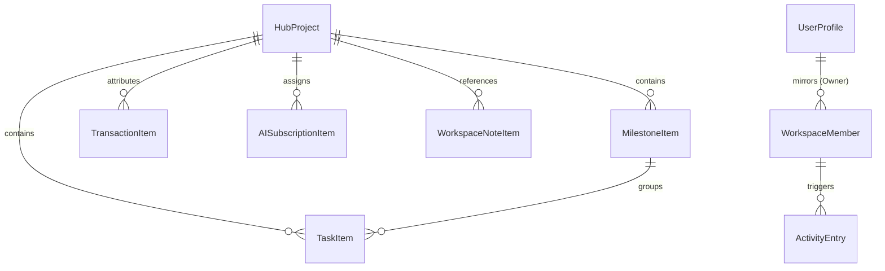

# Khai Space Hub — Current State Codebase & Data Audit
**Document Version:** 1.0.0  
**Phase:** Phase 3 Architecture & Persistence Planning  
**Application Target:** `apps/hub/`  
**Working Branch:** `feature/khai-space-hub`  
**Repository:** `khairultajudin/khaispace`

---

## 1. Executive Summary & Audit Methodology

This document provides a comprehensive, ground-truth audit of the Khai Space Hub frontend codebase as implemented through Phase 2G.2. 

The audit was conducted by direct inspection of:
1. TypeScript type declarations in [`apps/hub/src/types/dashboard.ts`](file:///e:/KhaiSpace/apps/hub/src/types/dashboard.ts).
2. Sample data catalogs and reference datasets in [`apps/hub/src/data/sample-dashboard-data.ts`](file:///e:/KhaiSpace/apps/hub/src/data/sample-dashboard-data.ts).
3. Business calculations, currency formatters, and utility libraries in [`apps/hub/src/utils/`](file:///e:/KhaiSpace/apps/hub/src/utils/).
4. Interactive views, forms, modals, and local state management across [`apps/hub/src/components/`](file:///e:/KhaiSpace/apps/hub/src/components/).
5. Configuration files, build scripts, and static export constraints in [`apps/hub/next.config.ts`](file:///e:/KhaiSpace/apps/hub/next.config.ts) and [`apps/hub/package.json`](file:///e:/KhaiSpace/apps/hub/package.json).

---

## 2. Global Application Architecture & Runtime Characteristics

### 2.1 Next.js 16 Static Export Constraints
- **Configuration:** `apps/hub/next.config.ts` declares `output: "export"` with `images: { unoptimized: true }`.
- **Runtime Environment:** The application is compiled into pure static client-side bundles (HTML, JavaScript, CSS). There is no active Node.js server, edge server middleware, or server-side API routes (`app/api/*`) executing in production.
- **Hosting Target:** Cloudflare Pages (or compatible static object store / CDN).
- **Navigation:** Client-side hash routing (`#overview`, `#projects`, `#tasks`, `#finance`, `#subscriptions`, `#notes`, `#settings`, and entity deep links such as `#project-<id>`, `#task-<id>`, `#tx-<id>`, `#note-<id>`, `#member-<id>`) handled in [`apps/hub/src/components/dashboard/dashboard-view.tsx`](file:///e:/KhaiSpace/apps/hub/src/components/dashboard/dashboard-view.tsx).

### 2.2 State Management Paradigm
- **Session-Only React State:** Every Hub module currently instantiates independent React state (`useState`) initialized with static data imported from `sample-dashboard-data.ts`.
- **Zero Persistence:** Any edits, additions, status changes, or deletions performed in the UI exist purely in browser memory. Reloading the page or navigating via full URL refresh resets all data back to the compile-time baseline.
- **Cross-Module Data Silos:** Because each module view independently clones sample arrays into its own component state, updates in one module do not synchronize with another. For example:
  - Renaming a project in `ProjectsView` does not update the `projectTitle` displayed on task cards in `TasksView` or transaction rows in `FinanceView`.
  - Creating a new project does not make it available in the subscription assignment dropdown until page reload.
  - Resetting baseline in one sub-tab or view affects only that view's state instance.

---

## 3. Comprehensive Module-by-Module Data Inventory

### 3.1 Overview & Workspace Identity
- **Primary Type Definitions:** `SummaryMetric`, `ActivityEntry`, `UserProfile`.
- **Current Data Store:** Static constants `SAMPLE_METRICS`, `RECENT_ACTIVITIES`, and `SAMPLE_OWNER_PROFILE`.
- **Data Inventory:**

| Entity | Current TypeScript Field | Data Type | Nullable / Optional | Description / Business Meaning | Proposed DB Target |
|:---|:---|:---|:---:|:---|:---|
| **UserProfile** | `id` | `string` | No | Unique profile identifier (`profile-owner`) | `profiles.id` (UUID references `auth.users`) |
| | `fullName` | `string` | No | Legal / display full name (`Khairul Tajudin`) | `profiles.full_name` |
| | `displayName` | `string` | No | Informal handle / callsign (`Khai`) | `profiles.display_name` |
| | `email` | `string` | No | Notification & login email (`khairul@khaispace.my`) | `profiles.email` |
| | `role` | `MemberRole` | No | Workspace permission tier (`Owner`) | `workspace_members.role` |
| | `bio` | `string` | No | Biographical summary & engineering focus | `profiles.bio` |
| | `location` | `string` | No | Physical operating base (`Kuala Lumpur, Malaysia`) | `profiles.location` |
| | `timezone` | `string` | No | Operating timezone (`Asia/Kuala_Lumpur (GMT+8)`) | `profiles.timezone` |
| | `avatarInitials` | `string` | No | Computed 2-letter uppercase monogram (`KT`) | Generated / derived |
| **ActivityEntry** | `id` | `string` | No | Activity event identifier (`act-1` .. `act-6`) | `activity_logs.id` (UUID) |
| | `action` | `string` | No | Summary description of operation performed | `activity_logs.action` |
| | `project` | `string` | No | Associated project name / slug | `activity_logs.project_id` (FK) |
| | `date` | `string` | No | Relative or human-readable date (`November 2, 2026`) | `activity_logs.created_at` (timestamptz) |
| | `category` | `enum` | No | Event category (`Documentation`, `Scaffold`, `Design`, `Planning`) | `activity_logs.category` |

---

### 3.2 Projects Module
- **Primary Type Definitions:** `HubProject`, `ProjectMetadata`, `ProjectStatus`.
- **Status Enum Values:** `"Active"` | `"Production"` | `"In Development"` | `"Planning"` | `"Documented"`.
- **Current Data Store:** `SAMPLE_PROJECTS` (7 active projects: `biztrack`, `smart-agro-telemetry`, `3d-clicker`, `memburu-jejak`, `ourduit`, `open-source-tooling`, `khai-space-infrastructure`).
- **Data Inventory:**

| Entity | Current TypeScript Field | Data Type | Nullable / Optional | Description / Business Meaning | Proposed DB Target |
|:---|:---|:---|:---:|:---|:---|
| **HubProject** | `id` | `string` | No | Unique slug identifier (e.g. `biztrack`) | `projects.id` (UUID PK; slug in `projects.slug`) |
| | `title` | `string` | No | Full human-readable project title | `projects.title` (varchar) |
| | `category` | `string` | No | High-level classification (e.g. `SaaS / Business Automation`) | `projects.category` (varchar) |
| | `status` | `ProjectStatus` | No | Lifecycle status | `projects.status` (enum `project_status`) |
| | `location` | `string` | No | Codebase directory (e.g. `apps/biztrack/`) | `projects.location` (varchar) |
| | `description` | `string` | No | Single-sentence architectural summary | `projects.description` (text) |
| | `fullDescription` | `string` | Optional | Expanded markdown-compatible scope statement | `projects.full_description` (text) |
| | `tags` | `string[]` | No | Categorical tags (e.g. `["Next.js", "IoT", "C++"]`) | `projects.tags` (text[] or JSONB) |
| | `metadata` | `ProjectMetadata` | Optional | Structured architectural audit metadata | `projects.metadata` (JSONB) |
| **ProjectMetadata** | `scope` | `string` | Optional | Architectural boundary definition | Inside `projects.metadata` |
| | `techStack` | `string` | Optional | Detailed libraries and hardware components | Inside `projects.metadata` |
| | `deliveryModel` | `string` | Optional | Deployment infrastructure (Cloudflare, VPS, On-Prem) | Inside `projects.metadata` |
| | `repositoryPath` | `string` | Optional | Relative git repository path | Inside `projects.metadata` |
| | `verificationStatus` | `enum` | Optional | `"Verified In-Tree"` \| `"Planned / Not Yet Implemented"` | Inside `projects.metadata` |
| | `pathStatus` | `enum` | Optional | `"Verified Filesystem Path"` \| `"Planned Location"` | Inside `projects.metadata` |
| | `stackStatus` | `enum` | Optional | `"Active Implementation"` \| `"Proposed / Not Implemented"` | Inside `projects.metadata` |

---

### 3.3 Tasks & Milestones Module
- **Primary Type Definitions:** `TaskItem`, `MilestoneItem`, `TaskPriority`, `TaskStatus`, `MilestoneStatus`.
- **Status & Priority Enums:**
  - `TaskPriority`: `"High"` | `"Medium"` | `"Normal"`
  - `TaskStatus`: `"In Progress"` | `"Pending"` | `"Completed"`
  - `MilestoneStatus`: `"Planned"` | `"In Progress"` | `"Completed"`
- **Current Data Store:** `SAMPLE_TASKS` (12 records), `SAMPLE_MILESTONES` (5 records).
- **Data Inventory:**

| Entity | Current TypeScript Field | Data Type | Nullable / Optional | Description / Business Meaning | Proposed DB Target |
|:---|:---|:---|:---:|:---|:---|
| **MilestoneItem** | `id` | `string` | No | Milestone identifier (e.g. `ms-clicker-mvp`) | `milestones.id` (UUID) |
| | `projectId` | `string` | No | Foreign project key | `milestones.project_id` (FK to projects) |
| | `projectTitle` | `string` | No | Denormalized project title for client rendering | Normalized via JOIN |
| | `title` | `string` | No | Milestone milestone name / deliverable | `milestones.title` (varchar) |
| | `targetDate` | `string` | No | Human-readable date (`November 20, 2026`) | Derived from date |
| | `targetDateIso` | `string` | No | ISO calendar date string (`2026-11-20`) | `milestones.target_date` (date) |
| | `status` | `MilestoneStatus` | No | Milestone execution state | `milestones.status` (enum `milestone_status`) |
| | `description` | `string` | No | Narrative objective and acceptance criteria | `milestones.description` (text) |
| | `relatedTaskIds` | `string[]` | No | Foreign keys of associated tasks | Inverse relation via `tasks.milestone_id` |
| **TaskItem** | `id` | `string` | No | Task identifier (e.g. `task-1`) | `tasks.id` (UUID) |
| | `title` | `string` | No | Actionable task headline | `tasks.title` (varchar) |
| | `projectId` | `string` | No | Foreign project key | `tasks.project_id` (FK to projects) |
| | `projectTitle` | `string` | No | Denormalized project title | Normalized via JOIN |
| | `milestoneId` | `string` | Optional | Associated milestone foreign key | `tasks.milestone_id` (FK to milestones) |
| | `milestoneTitle` | `string` | Optional | Denormalized milestone title | Normalized via JOIN |
| | `dueDate` | `string` | No | Human-readable date (`November 5, 2026`) | Derived from date |
| | `dueDateIso` | `string` | No | ISO calendar date string (`2026-11-05`) | `tasks.due_date` (date) |
| | `priority` | `TaskPriority` | No | Execution urgency | `tasks.priority` (enum `task_priority`) |
| | `status` | `TaskStatus` | No | Execution progress | `tasks.status` (enum `task_status`) |
| | `description` | `string` | No | Detailed requirements and acceptance notes | `tasks.description` (text) |

---

### 3.4 Finance & ROI Module
- **Primary Type Definitions:** `TransactionItem`, `TransactionType`, `ProjectFinanceSummary`, `MonthlyFinancialSummary`.
- **Transaction Types:** `"Income"` | `"Expense"` | `"Investment"`.
- **Current Data Store:** `SAMPLE_TRANSACTIONS` (12 records).
- **Critical Accounting Rules in Code ([`finance-utils.ts`](file:///e:/KhaiSpace/apps/hub/src/utils/finance-utils.ts)):**
  1. **Monetary Unit:** Strictly Malaysian Ringgit (`MYR` / `RM`).
  2. **Categorical Separation:** Operating expenses vs Capital investment outlays are completely separated.
  3. **Strict ROI Rule:** Project and overall ROI are calculated **only** from income transactions where `isInvestmentReturn === true`.
  4. **No Operating Fallback:** Operating revenue (retainers, service fees, pilot client sales) is strictly excluded from investment return calculations to avoid misleading financial metrics.
  5. **Orphan Projects:** Transactions with no project or unassigned projects are categorized under `"general-ops"` (General Operations / Shared).
- **Data Inventory:**

| Entity | Current TypeScript Field | Data Type | Nullable / Optional | Description / Business Meaning | Proposed DB Target |
|:---|:---|:---|:---:|:---|:---|
| **TransactionItem** | `id` | `string` | No | Ledger transaction ID (`tx-01` .. `tx-12`) | `financial_transactions.id` (UUID) |
| | `description` | `string` | No | Transaction narration / invoice item | `financial_transactions.description` |
| | `date` | `string` | No | Formatted human date (`November 4, 2026`) | Derived from date |
| | `dateIso` | `string` | No | ISO calendar date (`2026-11-04`) | `financial_transactions.transaction_date` (date) |
| | `type` | `TransactionType` | No | Ledger account classification | `financial_transactions.type` (enum `transaction_type`) |
| | `category` | `string` | No | Expense/Revenue category tag | `financial_transactions.category` (varchar) |
| | `amount` | `number` | No | Monetary value in MYR (float in JS) | `financial_transactions.amount` (`numeric(12,2)`) |
| | `projectId` | `string` | Optional | Associated project foreign key | `financial_transactions.project_id` (FK) |
| | `projectTitle` | `string` | Optional | Denormalized project title | Normalized via JOIN |
| | `isInvestmentReturn`| `boolean` | Optional | Explicit tag certifying capital return | `financial_transactions.is_investment_return` (boolean) |
| | `notes` | `string` | Optional | Additional accounting context or audit notes | `financial_transactions.notes` (text) |

---

### 3.5 AI Subscriptions Module
- **Primary Type Definitions:** `AISubscriptionItem`, `SubscriptionStatus`, `SubscriptionBillingCycle`, `SubscriptionCostGroup`.
- **Status Enums:** `"Active"` | `"Paused"` | `"Cancelled"` | `"Trial"`.
- **Billing Cycles:** `"Monthly"` | `"Annual"`.
- **Current Data Store:** `SAMPLE_SUBSCRIPTIONS` (8 items: Claude Pro, ChatGPT Plus, GitHub Copilot, Midjourney, Cursor Pro, Perplexity Pro, ElevenLabs, Runway Gen-2).
- **Calculations in Code ([`subscription-utils.ts`](file:///e:/KhaiSpace/apps/hub/src/utils/subscription-utils.ts)):**
  - Monthly equivalent = `billingCycle === "Annual" ? amount / 12 : amount`.
  - Annual equivalent = `billingCycle === "Annual" ? amount : amount * 12`.
  - Non-active (Cancelled, Paused) items are excluded from active recurring commitment totals.
  - Zero automatic duplication into the financial transaction ledger.
- **Data Inventory:**

| Entity | Current TypeScript Field | Data Type | Nullable / Optional | Description / Business Meaning | Proposed DB Target |
|:---|:---|:---|:---:|:---|:---|
| **AISubscriptionItem** | `id` | `string` | No | Subscription ID (`sub-01` .. `sub-08`) | `ai_subscriptions.id` (UUID) |
| | `provider` | `string` | No | Vendor organization (`Anthropic`, `OpenAI`) | `ai_subscriptions.provider` (varchar) |
| | `productName` | `string` | No | Tool / product name (`Claude Pro`) | `ai_subscriptions.product_name` (varchar) |
| | `planName` | `string` | No | Tier / tier description (`Pro Tier`) | `ai_subscriptions.plan_name` (varchar) |
| | `category` | `string` | No | Tool domain (`Code Assistant`, `Research`) | `ai_subscriptions.category` (varchar) |
| | `billingCycle` | `enum` | No | Recurrence frequency (`Monthly`, `Annual`) | `ai_subscriptions.billing_cycle` (enum) |
| | `amount` | `number` | No | Subscription price in MYR (e.g. `95.00`) | `ai_subscriptions.amount` (`numeric(12,2)`) |
| | `currency` | `"MYR"` | No | Fixed monetary currency standard | `ai_subscriptions.currency` (varchar(3)) |
| | `status` | `SubscriptionStatus` | No | Account status | `ai_subscriptions.status` (enum) |
| | `startDateIso` | `string` | No | Subscription inception date (`2026-01-15`) | `ai_subscriptions.start_date` (date) |
| | `nextBillingDateIso`| `string` | No | Upcoming renewal date (`2026-11-15`) | `ai_subscriptions.next_billing_date` (date) |
| | `assignedProjectId`| `string` | Optional | Associated project foreign key | `ai_subscriptions.assigned_project_id` (FK) |
| | `purpose` | `string` | No | Functional justification | `ai_subscriptions.purpose` (text) |
| | `notes` | `string` | Optional | Renewal instructions or seat details | `ai_subscriptions.notes` (text) |

---

### 3.6 Notes & Decisions Module
- **Primary Type Definitions:** `WorkspaceNoteItem`, `NoteRecordType`, `DecisionStatus`, `NoteMetricsSummary`.
- **Record Types:** `"Note"` | `"Decision"`.
- **Decision Statuses:** `"Proposed"` | `"Approved"` | `"Rejected"` | `"Superseded"`.
- **Current Data Store:** `SAMPLE_NOTES` (10 records: 5 notes, 5 decisions).
- **Critical Rules in Code ([`notes-utils.ts`](file:///e:/KhaiSpace/apps/hub/src/utils/notes-utils.ts)):**
  - Type immutability: When editing a record, changing type between `Note` and `Decision` is strictly prohibited.
  - IDs are prefixed and collision-resistant: `note-<timestamp>-<rand>` or `dec-<timestamp>-<rand>`.
- **Data Inventory:**

| Entity | Current TypeScript Field | Data Type | Nullable / Optional | Description / Business Meaning | Proposed DB Target |
|:---|:---|:---|:---:|:---|:---|
| **WorkspaceNoteItem** | `id` | `string` | No | Collision-resistant ID (`note-1`, `dec-1`) | `workspace_notes.id` (UUID PK; slug in `workspace_notes.slug`) |
| | `type` | `NoteRecordType` | No | Record classification (`Note`, `Decision`) | `workspace_notes.type` (enum `note_record_type`) |
| | `title` | `string` | No | Document title | `workspace_notes.title` (varchar) |
| | `content` | `string` | No | Markdown content / working notes | `workspace_notes.content` (text) |
| | `category` | `string` | No | Subject classification | `workspace_notes.category` (varchar) |
| | `tags` | `string[]` | No | Categorical tags | `workspace_notes.tags` (text[]) |
| | `projectId` | `string` | Optional | Associated project foreign key | `workspace_notes.project_id` (FK) |
| | `projectTitle` | `string` | Optional | Denormalized project title | Normalized via JOIN |
| | `createdAtIso` | `string` | No | ISO timestamp (`2026-10-25T14:30:00Z`) | `workspace_notes.created_at` (timestamptz) |
| | `updatedAtIso` | `string` | No | ISO timestamp of last modification | `workspace_notes.updated_at` (timestamptz) |
| | `status` | `DecisionStatus` | Optional | Decision status (`Approved`, `Proposed`, etc.) | `workspace_notes.decision_status` (enum) |
| | `rationale` | `string` | Optional | Architectural / business reasoning | `workspace_notes.rationale` (text) |
| | `impact` | `string` | Optional | Downstream effects on scope or cost | `workspace_notes.impact` (text) |

---

### 3.7 Members & Settings Module
- **Primary Type Definitions:** `WorkspaceMember`, `MemberRole`, `MemberStatus`, `WorkspaceSettings`, `DateFormatOption`, `ContentDensity`.
- **Roles:** `"Owner"` | `"Administrator"` | `"Member"` | `"Viewer"`.
- **Statuses:** `"Active"` | `"Pending"` | `"Suspended"`.
- **Current Data Store:** `SAMPLE_MEMBERS` (7 records), `SAMPLE_OWNER_PROFILE`, `SAMPLE_WORKSPACE_SETTINGS`.
- **Critical Rules in Code:**
  - Owner record (`role === "Owner"`) is immutable: cannot be deleted or suspended.
  - Profile reset synchronizes the Owner entry in the member directory.
  - Content density is an interactive preference preview for sample data cards.
  - Accounting currency is a fixed workspace standard (`MYR (RM)`).
- **Data Inventory:**

| Entity | Current TypeScript Field | Data Type | Nullable / Optional | Description / Business Meaning | Proposed DB Target |
|:---|:---|:---|:---:|:---|:---|
| **WorkspaceMember** | `id` | `string` | No | Member identifier (`mem-1` .. `mem-7`) | `workspace_members.id` (UUID) |
| | `name` | `string` | No | Collaborator full name | `profiles.full_name` via `user_id` |
| | `email` | `string` | No | Collaborator corporate/login email | `profiles.email` via `user_id` |
| | `role` | `MemberRole` | No | RBAC permission level | `workspace_members.role` (enum `member_role`) |
| | `status` | `MemberStatus` | No | Account status (`Active`, `Suspended`) | `workspace_members.status` (enum `member_status`) |
| | `joinedAtIso` | `string` | No | Inception timestamp (`2026-01-10`) | `workspace_members.joined_at` (timestamptz) |
| | `bio` | `string` | Optional | Professional role description | `workspace_members.bio` (text) |
| | `invitedBy` | `string` | Optional | Name / email of inviter | `workspace_members.invited_by` (FK to profiles) |
| | `personalMessage` | `string` | Optional | Invitation note | `workspace_invitations.personal_message` |
| **WorkspaceSettings** | `workspaceName` | `string` | No | Workspace display name (`Khai Space Command Center`) | `workspaces.name` (varchar) |
| | `workspaceDescription`| `string` | No | Workspace mission statement | `workspaces.description` (text) |
| | `timezone` | `string` | No | Default operating timezone | `workspaces.timezone` (varchar) |
| | `defaultCurrency` | `string` | No | Monetary standard (`MYR (RM)`) | `workspaces.default_currency` (varchar) |
| | `dateFormat` | `DateFormatOption`| No | Calendar format (`YYYY-MM-DD`, etc.) | `workspaces.date_format` (varchar) |
| | `contentDensity` | `ContentDensity` | No | Spacing density preference preview | `workspaces.content_density` (varchar) |
| | `notifications.taskReminders` | `boolean` | No | Task due date alert flag | `workspace_settings.notification_task_reminders` |
| | `notifications.milestoneUpdates` | `boolean` | No | Milestone completion alert flag | `workspace_settings.notification_milestone_updates` |
| | `notifications.projectUpdates` | `boolean` | No | Project status shift alert flag | `workspace_settings.notification_project_updates` |
| | `notifications.workspaceActivity` | `boolean` | No | Roster changes alert flag | `workspace_settings.notification_workspace_activity` |
| | `notifications.subscriptionRenewals`| `boolean`| No | 30-day renewal alert flag | `workspace_settings.notification_subscription_renewals` |

---

## 4. Cross-Module Dependencies & Existing Foreign-Key Relationships

The audit identified the following logical entity relationships currently emulated in React session code:

1. **Project as Primary Organizational Hub:**
   - Tasks reference `projectId`.
   - Milestones reference `projectId`.
   - Tasks optionally reference `milestoneId`.
   - Transactions optionally reference `projectId`. If omitted, treated as shared/general operations.
   - AI Subscriptions optionally reference `assignedProjectId`.
   - Notes & Decisions optionally reference `projectId`.
2. **Denormalization Defect in Current Code:**
   - Existing sample models store both `projectId` and `projectTitle` on the same record (e.g. in `TaskItem`, `TransactionItem`, `AISubscriptionItem`, `WorkspaceNoteItem`).
   - If a project is renamed, denormalized titles in other modules become stale.
   - **Persistence Solution:** In the relational PostgreSQL schema, store only `project_id` foreign keys and dynamically resolve `projects.title` via SQL joins or PostgREST resource embedding.

---

## 5. Session-State Limitations & Risks

1. **Data Loss on Refresh:** All modifications in the browser disappear on page reload.
2. **No Multi-User Concurrency:** Changes made by one collaborator (e.g. Khai's wife) are invisible to other active sessions.
3. **No Centralized Authorization:** Role permissions (`Owner`, `Administrator`, `Member`, `Viewer`) are simulated by simple UI checks that can be inspected and bypassed in browser memory.
4. **Lack of Transactional Integrity:** Financial transactions are stored in client memory; deleting a project leaves dangling or inconsistent project tags in financial summaries.
5. **No Immutable Audit Trail:** Sensitive actions (deleting financial investments, altering decision statuses) leave no permanent historical trace.

---

## 6. Recommendations for Database Normalization

1. **Extract Workspace Tenant Root (`workspaces` table):**
   - Introduce a multi-tenant root table `workspaces` with UUID primary keys.
   - Every entity in the database must reference `workspace_id` to enforce Row Level Security.
2. **Normalize Denormalized Strings:**
   - Eliminate redundant `projectTitle`, `milestoneTitle`, and human-formatted dates (`dueDate`, `targetDate`).
   - Store standard PostgreSQL `date` or `timestamptz` types and format them on the client using existing `date-utils.ts`.
3. **Enforce Exact Monetary Storage:**
   - Replace JavaScript `number` (IEEE 754 floating-point) with PostgreSQL `numeric(12, 2)` for all transaction amounts and subscription prices.
4. **Enforce Database-Level Referential Integrity:**
   - Use `ON DELETE RESTRICT` or `ON DELETE SET NULL` for financial transactions to guarantee ledger preservation even if an associated project is removed.
   - Use `ON DELETE CASCADE` for tightly bound child records (tasks and milestones belonging to a deleted project).
5. **Separate Development Sample Data from Production Data:**
   - Maintain the sample data file strictly as an offline demonstration seed or development mock.
   - Production instances must query real PostgreSQL tables via Supabase.
