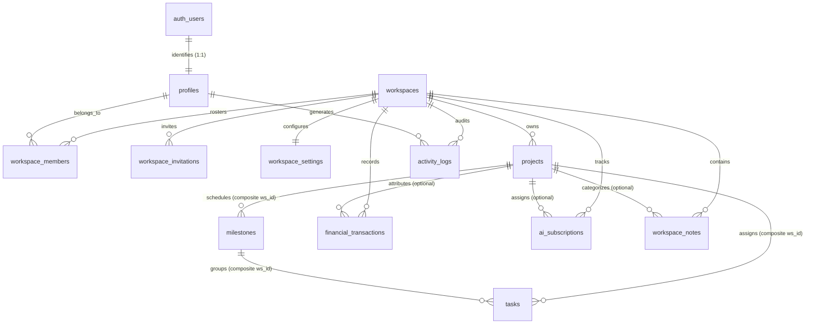

# Khai Space Hub — Normalized PostgreSQL Database Schema
**Document Version:** 1.1.0 (Phase 3.1 Security Hardened)  
**Phase:** Phase 3.1 Security & Architecture Correction Pass  
**Application Target:** `apps/hub/`  
**Working Branch:** `feature/khai-space-hub`  
**Repository:** `khairultajudin/khaispace`

---

## 1. Schema Design Philosophy

The Khai Space Hub schema is engineered to production standards of relational normalization, cross-workspace isolation, and financial accuracy:

1. **Standardized UUIDv4 Primary Keys:** All tables use `uuid` primary keys generated by `gen_random_uuid()` to eliminate sequential enumeration vulnerabilities and provide cross-workspace portability.
2. **Universal Workspace Scoping & Composite Integrity:** Every workspace-owned entity includes a mandatory `workspace_id uuid NOT NULL REFERENCES workspaces(id) ON DELETE CASCADE`. Composite unique constraints (`workspace_id, id`) and composite foreign keys guarantee that child entities cannot reference parent entities in a different workspace.
3. **Single Owner Guarantee:** Enforced via a partial unique index `idx_workspace_single_owner` on `workspace_members(workspace_id) WHERE (role = 'Owner')`.
4. **Exact Decimal Monetary Representation:** All financial currencies are stored as `numeric(12, 2)`. Floating-point types (`float`, `real`, `double precision`) are strictly prohibited.
5. **Calendar Date vs Instant Separation:**
   - Calendar-only dates (e.g. task due dates, subscription billing dates, transaction dates) are stored as PostgreSQL `date` (`YYYY-MM-DD`).
   - Exact temporal instants (audit logs, created/updated timestamps) are stored as `timestamptz` in UTC.
6. **Automatic Timestamp Maintenance:** All 10 mutable tables implement active triggers executing `handle_updated_at()`.

---

## 2. Mermaid Entity-Relationship Diagram (ERD)

---

## 3. Comprehensive Table Specifications

### 3.1 `workspaces` (Tenant Boundary)
- **Primary Key:** `id uuid DEFAULT gen_random_uuid()`
- **Columns:**
  - `name varchar(100) NOT NULL`
  - `description text NOT NULL DEFAULT ''`
  - `timezone varchar(50) NOT NULL DEFAULT 'Asia/Kuala_Lumpur (GMT+8)'`
  - `default_currency varchar(10) NOT NULL DEFAULT 'MYR (RM)'`
  - `date_format varchar(20) NOT NULL DEFAULT 'YYYY-MM-DD'`
  - `content_density varchar(20) NOT NULL DEFAULT 'comfortable'`
  - `created_at timestamptz NOT NULL DEFAULT now()`
  - `updated_at timestamptz NOT NULL DEFAULT now()` (Trigger installed)
  - `created_by uuid REFERENCES auth.users(id) ON DELETE SET NULL`
- **Deletion Policy:** Restricted to Owner only.

---

### 3.2 `profiles` (User Identity)
- **Primary Key:** `id uuid REFERENCES auth.users(id) ON DELETE CASCADE`
- **Columns:**
  - `full_name varchar(100) NOT NULL`
  - `display_name varchar(50) NOT NULL`
  - `email varchar(255) NOT NULL UNIQUE`
  - `bio text NOT NULL DEFAULT ''`
  - `location varchar(100) NOT NULL DEFAULT 'Kuala Lumpur, Malaysia'`
  - `timezone varchar(50) NOT NULL DEFAULT 'Asia/Kuala_Lumpur (GMT+8)'`
  - `avatar_initials varchar(4) NOT NULL DEFAULT 'KT'`
  - `created_at timestamptz NOT NULL DEFAULT now()`
  - `updated_at timestamptz NOT NULL DEFAULT now()` (Trigger installed)

---

### 3.3 `workspace_members` (Roster & RBAC)
- **Primary Key:** `id uuid DEFAULT gen_random_uuid()`
- **Columns:**
  - `workspace_id uuid NOT NULL REFERENCES workspaces(id) ON DELETE CASCADE`
  - `user_id uuid NOT NULL REFERENCES profiles(id) ON DELETE CASCADE`
  - `role member_role NOT NULL DEFAULT 'Member'` (`'Owner'`, `'Administrator'`, `'Member'`, `'Viewer'`)
  - `status member_status NOT NULL DEFAULT 'Active'` (`'Active'`, `'Pending'`, `'Suspended'`)
  - `bio text`
  - `invited_by uuid REFERENCES profiles(id) ON DELETE SET NULL`
  - `joined_at timestamptz NOT NULL DEFAULT now()`
  - `created_at timestamptz NOT NULL DEFAULT now()`
  - `updated_at timestamptz NOT NULL DEFAULT now()` (Trigger installed)
- **Constraints & Indexes:**
  - `CONSTRAINT uq_workspace_member UNIQUE (workspace_id, user_id)`
  - `CREATE UNIQUE INDEX idx_workspace_single_owner ON workspace_members (workspace_id) WHERE (role = 'Owner');`
- **Triggers:** `protect_workspace_owner()` prevents deleting, demoting, or transferring the Owner.

---

### 3.4 `workspace_invitations` (Collaborator Onboarding)
- **Primary Key:** `id uuid DEFAULT gen_random_uuid()`
- **Columns:**
  - `workspace_id uuid NOT NULL REFERENCES workspaces(id) ON DELETE CASCADE`
  - `email varchar(255) NOT NULL`
  - `role member_role NOT NULL DEFAULT 'Member'`
  - `token_hash text NOT NULL`
  - `status varchar(20) NOT NULL DEFAULT 'pending'`
  - `personal_message text`
  - `invited_by uuid NOT NULL REFERENCES profiles(id) ON DELETE CASCADE`
  - `expires_at timestamptz NOT NULL DEFAULT (now() + interval '7 days')`
  - `created_at timestamptz NOT NULL DEFAULT now()`
- **Constraints:** `CHECK (role != 'Owner')` (Cannot invite as Owner).

---

### 3.5 `workspace_settings` (Configuration & Flags)
- **Primary Key:** `workspace_id uuid REFERENCES workspaces(id) ON DELETE CASCADE`
- **Columns:**
  - `notification_task_reminders boolean NOT NULL DEFAULT true`
  - `notification_milestone_updates boolean NOT NULL DEFAULT true`
  - `notification_project_updates boolean NOT NULL DEFAULT true`
  - `notification_workspace_activity boolean NOT NULL DEFAULT false`
  - `notification_subscription_renewals boolean NOT NULL DEFAULT true`
  - `updated_at timestamptz NOT NULL DEFAULT now()` (Trigger installed)

---

### 3.6 `projects` (Engineering Catalog)
- **Primary Key:** `id uuid DEFAULT gen_random_uuid()`
- **Columns:**
  - `workspace_id uuid NOT NULL REFERENCES workspaces(id) ON DELETE CASCADE`
  - `slug varchar(50) NOT NULL` (e.g. `biztrack`, `smart-agro-telemetry`)
  - `title varchar(150) NOT NULL`
  - `category varchar(100) NOT NULL`
  - `status project_status NOT NULL DEFAULT 'Planning'`
  - `location varchar(200) NOT NULL DEFAULT ''`
  - `description text NOT NULL`
  - `full_description text`
  - `tags text[] NOT NULL DEFAULT '{}'`
  - `metadata jsonb NOT NULL DEFAULT '{}'::jsonb`
  - `created_at timestamptz NOT NULL DEFAULT now()`
  - `updated_at timestamptz NOT NULL DEFAULT now()` (Trigger installed)
  - `created_by uuid REFERENCES profiles(id) ON DELETE SET NULL`
- **Constraints & Indexes:**
  - `CONSTRAINT uq_projects_ws_slug UNIQUE (workspace_id, slug)`
  - `CONSTRAINT uq_projects_ws_id UNIQUE (workspace_id, id)`

---

### 3.7 `milestones` (Project Milestones)
- **Primary Key:** `id uuid DEFAULT gen_random_uuid()`
- **Columns:**
  - `workspace_id uuid NOT NULL REFERENCES workspaces(id) ON DELETE CASCADE`
  - `project_id uuid NOT NULL`
  - `slug varchar(50)`
  - `title varchar(150) NOT NULL`
  - `target_date date NOT NULL`
  - `status milestone_status NOT NULL DEFAULT 'Planned'`
  - `description text NOT NULL DEFAULT ''`
  - `created_at timestamptz NOT NULL DEFAULT now()`
  - `updated_at timestamptz NOT NULL DEFAULT now()` (Trigger installed)
  - `created_by uuid REFERENCES profiles(id) ON DELETE SET NULL`
- **Composite Foreign Key:**
  - `CONSTRAINT fk_milestone_project_ws FOREIGN KEY (workspace_id, project_id) REFERENCES projects(workspace_id, id) ON DELETE CASCADE`
  - `CONSTRAINT uq_milestones_ws_id UNIQUE (workspace_id, id)`

---

### 3.8 `tasks` (Actionable Items)
- **Primary Key:** `id uuid DEFAULT gen_random_uuid()`
- **Columns:**
  - `workspace_id uuid NOT NULL REFERENCES workspaces(id) ON DELETE CASCADE`
  - `project_id uuid NOT NULL`
  - `milestone_id uuid`
  - `title varchar(200) NOT NULL`
  - `priority task_priority NOT NULL DEFAULT 'Normal'`
  - `status task_status NOT NULL DEFAULT 'Pending'`
  - `due_date date NOT NULL`
  - `description text NOT NULL DEFAULT ''`
  - `created_at timestamptz NOT NULL DEFAULT now()`
  - `updated_at timestamptz NOT NULL DEFAULT now()` (Trigger installed)
  - `created_by uuid REFERENCES profiles(id) ON DELETE SET NULL`
- **Composite Foreign Keys:**
  - `CONSTRAINT fk_task_project_ws FOREIGN KEY (workspace_id, project_id) REFERENCES projects(workspace_id, id) ON DELETE CASCADE`
  - `CONSTRAINT fk_task_milestone_ws FOREIGN KEY (workspace_id, milestone_id) REFERENCES milestones(workspace_id, id) ON DELETE SET NULL`

---

### 3.9 `financial_transactions` (Ledger Entries)
- **Primary Key:** `id uuid DEFAULT gen_random_uuid()`
- **Columns:**
  - `workspace_id uuid NOT NULL REFERENCES workspaces(id) ON DELETE CASCADE`
  - `project_id uuid` (Optional; NULL indicates General Operations / Shared)
  - `transaction_date date NOT NULL`
  - `type transaction_type NOT NULL` (`'Income'`, `'Expense'`, `'Investment'`)
  - `category varchar(100) NOT NULL`
  - `amount numeric(12, 2) NOT NULL`
  - `description text NOT NULL`
  - `notes text`
  - `is_investment_return boolean NOT NULL DEFAULT false`
  - `created_at timestamptz NOT NULL DEFAULT now()`
  - `updated_at timestamptz NOT NULL DEFAULT now()` (Trigger installed)
  - `created_by uuid REFERENCES profiles(id) ON DELETE SET NULL`
- **Constraints & Triggers:**
  - `CHECK (amount > 0)`
  - `CHECK ((type = 'Income') OR (is_investment_return = false))`
  - `trg_tx_project_ws_integrity`: Validates `project_id` belongs to `workspace_id`.
  - `trg_project_deletion_cleanup`: On project deletion, cleanly sets `project_id = NULL` preserving ledger history.

---

### 3.10 `ai_subscriptions` (AI Licenses)
- **Primary Key:** `id uuid DEFAULT gen_random_uuid()`
- **Columns:**
  - `workspace_id uuid NOT NULL REFERENCES workspaces(id) ON DELETE CASCADE`
  - `assigned_project_id uuid`
  - `provider varchar(100) NOT NULL`
  - `product_name varchar(100) NOT NULL`
  - `plan_name varchar(100) NOT NULL`
  - `category varchar(100) NOT NULL`
  - `billing_cycle billing_cycle NOT NULL DEFAULT 'Monthly'`
  - `amount numeric(12, 2) NOT NULL`
  - `currency varchar(3) NOT NULL DEFAULT 'MYR'`
  - `status subscription_status NOT NULL DEFAULT 'Active'`
  - `start_date date NOT NULL`
  - `next_billing_date date NOT NULL`
  - `purpose text NOT NULL`
  - `notes text`
  - `created_at timestamptz NOT NULL DEFAULT now()`
  - `updated_at timestamptz NOT NULL DEFAULT now()` (Trigger installed)
  - `created_by uuid REFERENCES profiles(id) ON DELETE SET NULL`

---

### 3.11 `workspace_notes` (Notes & ADRs)
- **Primary Key:** `id uuid DEFAULT gen_random_uuid()`
- **Columns:**
  - `workspace_id uuid NOT NULL REFERENCES workspaces(id) ON DELETE CASCADE`
  - `project_id uuid`
  - `type note_record_type NOT NULL DEFAULT 'Note'` (`'Note'`, `'Decision'`)
  - `title varchar(200) NOT NULL`
  - `content text NOT NULL`
  - `category varchar(100) NOT NULL`
  - `tags text[] NOT NULL DEFAULT '{}'`
  - `decision_status decision_status`
  - `rationale text`
  - `impact text`
  - `created_at timestamptz NOT NULL DEFAULT now()`
  - `updated_at timestamptz NOT NULL DEFAULT now()` (Trigger installed)
  - `created_by uuid REFERENCES profiles(id) ON DELETE SET NULL`
- **Triggers:** `trg_note_type_immutability` blocks changing type between Note and Decision.

---

### 3.12 `activity_logs` (Audit Trail)
- **Primary Key:** `id uuid DEFAULT gen_random_uuid()`
- **Columns:**
  - `workspace_id uuid NOT NULL REFERENCES workspaces(id) ON DELETE CASCADE`
  - `user_id uuid NOT NULL DEFAULT auth.uid() REFERENCES profiles(id) ON DELETE SET NULL`
  - `action varchar(255) NOT NULL`
  - `entity_type varchar(50) NOT NULL`
  - `entity_id uuid NOT NULL`
  - `project_id uuid`
  - `category varchar(50) NOT NULL`
  - `metadata jsonb NOT NULL DEFAULT '{}'::jsonb`
  - `created_at timestamptz NOT NULL DEFAULT now()`
- **Immutability:** `UPDATE` and `DELETE` blocked via RLS; `trg_activity_log_integrity` forces trusted `user_id` and server `now()`.
