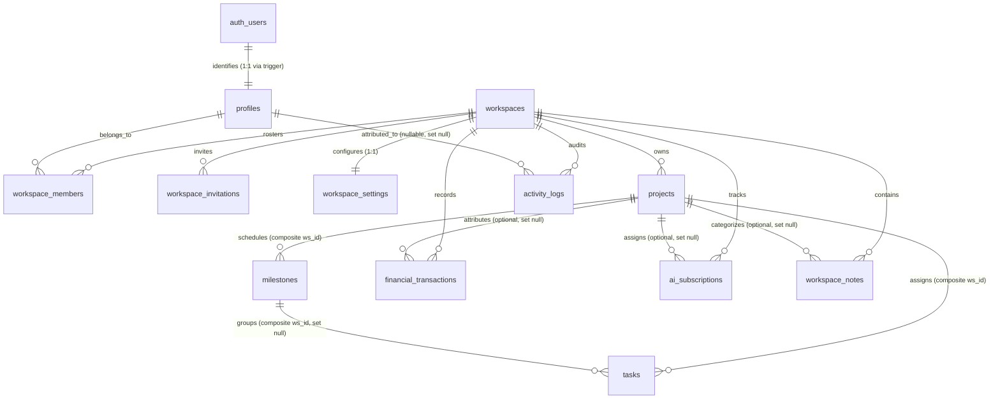

# Khai Space Hub — Normalized PostgreSQL Database Schema
**Document Version:** 1.3.0 (Phase 3.3 Security & Integrity Validation Finalized)  
**Phase:** Phase 3.3 Final SQL Validation & Security Closure  
**Application Target:** `apps/hub/`  
**Working Branch:** `feature/khai-space-hub`  
**Repository:** `khairultajudin/khaispace`

---

## 1. Schema Design Philosophy

The Khai Space Hub schema is engineered to production standards of relational normalization, cross-workspace isolation, and financial accuracy:

1. **Standardized UUID Primary Key Model:**
   - 10 entity and event tables use `id uuid PRIMARY KEY DEFAULT gen_random_uuid()` to eliminate sequential enumeration vulnerabilities.
   - `profiles` uses `id uuid PRIMARY KEY REFERENCES auth.users(id) ON DELETE CASCADE` (strict 1:1 foreign key binding to Supabase Auth).
   - `workspace_settings` uses `workspace_id uuid PRIMARY KEY REFERENCES workspaces(id) ON DELETE CASCADE` (strict 1:1 configuration binding).
2. **Universal Workspace Scoping & Composite Integrity:**
   - Every workspace-owned entity includes a mandatory `workspace_id uuid NOT NULL REFERENCES workspaces(id) ON DELETE CASCADE`.
   - Child tables with composite relationships (`milestones`, `tasks`) implement composite unique constraints (`workspace_id, id`) and composite foreign keys to guarantee multi-tenant tenant isolation at the database engine level.
3. **Tasks Milestone Foreign Key Nullification:**
   - Tasks reference milestones via `CONSTRAINT fk_task_milestone_ws FOREIGN KEY (workspace_id, milestone_id) REFERENCES public.milestones(workspace_id, id) ON DELETE SET NULL (milestone_id)`.
   - In PostgreSQL 15+, column-specific `ON DELETE SET NULL (milestone_id)` nullifies only `milestone_id` upon milestone deletion while strictly preserving the mandatory `workspace_id`.
   - A fallback cleanup trigger (`handle_milestone_deletion_cleanup()`) provides defense-in-depth against version drift.
4. **Complete Optional Project Reference Integrity:**
   - All optional project references (`financial_transactions.project_id`, `ai_subscriptions.assigned_project_id`, `workspace_notes.project_id`) are validated by triggers ensuring they belong to the same `workspace_id`.
   - On project deletion, `handle_project_deletion_cleanup()` safely unassigns these three relationships (setting them to `NULL`) without deleting historical financial ledgers or notes.
5. **Exact Decimal Monetary Representation:** All monetary amounts are stored as `numeric(12, 2)`. Floating-point types are strictly prohibited.
6. **Automatic Timestamp Maintenance:** All 10 mutable tables implement active triggers executing `handle_updated_at()`.
7. **Strict Admin & Owner Boundary Enforcement:** Database triggers and RLS policies guarantee that Administrators cannot modify other Administrators, promote anyone to Administrator, or alter the Owner.

---

## 2. Mermaid Entity-Relationship Diagram (ERD)

---

## 3. Comprehensive Table Specifications

### 3.1 `workspaces` (Tenant Boundary)
- **Primary Key:** `id uuid DEFAULT gen_random_uuid()`
- **Columns:**
  - `name varchar(100) NOT NULL`
  - `description text NOT NULL DEFAULT ''`
  - `timezone varchar(50) NOT NULL DEFAULT 'Asia/Kuala_Lumpur (GMT+8)'`
  - `default_currency varchar(10) NOT NULL DEFAULT 'MYR (RM)'`
  - `date_format varchar(20) NOT NULL DEFAULT 'YYYY-MM-DD'`
  - `content_density varchar(20) NOT NULL DEFAULT 'comfortable'`
  - `created_at timestamptz NOT NULL DEFAULT now()`
  - `updated_at timestamptz NOT NULL DEFAULT now()` (Trigger installed)
  - `created_by uuid REFERENCES auth.users(id) ON DELETE SET NULL`
- **Provisioning & Deletion:**
  - Direct client `INSERT` is disabled; created via `create_workspace_with_owner()`.
  - Direct client `DELETE` is protected by `trg_workspace_deletion_auth` (Owner only).

---

### 3.2 `profiles` (User Identity)
- **Primary Key:** `id uuid REFERENCES auth.users(id) ON DELETE CASCADE`
- **Columns:**
  - `full_name varchar(100) NOT NULL`
  - `display_name varchar(50) NOT NULL`
  - `email varchar(255) NOT NULL UNIQUE`
  - `bio text NOT NULL DEFAULT ''`
  - `location varchar(100) NOT NULL DEFAULT 'Kuala Lumpur, Malaysia'`
  - `timezone varchar(50) NOT NULL DEFAULT 'Asia/Kuala_Lumpur (GMT+8)'`
  - `avatar_initials varchar(4) NOT NULL DEFAULT 'KT'`
  - `created_at timestamptz NOT NULL DEFAULT now()`
  - `updated_at timestamptz NOT NULL DEFAULT now()` (Trigger installed)
- **Auto-Provisioning:** Created automatically by `handle_new_user()` via `on_auth_user_created` trigger on `auth.users`.

---

### 3.3 `workspace_members` (Roster & RBAC)
- **Primary Key:** `id uuid DEFAULT gen_random_uuid()`
- **Columns:**
  - `workspace_id uuid NOT NULL REFERENCES workspaces(id) ON DELETE CASCADE`
  - `user_id uuid NOT NULL REFERENCES profiles(id) ON DELETE CASCADE`
  - `role member_role NOT NULL DEFAULT 'Member'` (`'Owner'`, `'Administrator'`, `'Member'`, `'Viewer'`)
  - `status member_status NOT NULL DEFAULT 'Active'` (`'Active'`, `'Pending'`, `'Suspended'`)
  - `bio text`
  - `invited_by uuid REFERENCES profiles(id) ON DELETE SET NULL`
  - `joined_at timestamptz NOT NULL DEFAULT now()`
  - `created_at timestamptz NOT NULL DEFAULT now()`
  - `updated_at timestamptz NOT NULL DEFAULT now()` (Trigger installed)
- **Constraints & Indexes:**
  - `uq_workspace_member UNIQUE (workspace_id, user_id)`
  - `idx_workspace_single_owner UNIQUE (workspace_id) WHERE (role = 'Owner')`
- **Triggers:**
  - `protect_workspace_members_immutability()`: blocks changes to `user_id`, `workspace_id`, role self-promotions, Owner role assignments, and prevents Administrators from modifying other Administrators or promoting to Administrator.
  - `protect_workspace_members_deletion()`: blocks deleting the Owner record (unless during authorized workspace teardown) and blocks Administrators from deleting other Administrators.

---

### 3.4 `workspace_invitations` (Secure Onboarding)
- **Primary Key:** `id uuid DEFAULT gen_random_uuid()`
- **Columns:**
  - `workspace_id uuid NOT NULL REFERENCES workspaces(id) ON DELETE CASCADE`
  - `email varchar(255) NOT NULL`
  - `role member_role NOT NULL DEFAULT 'Member'`
  - `token_hash text NOT NULL` (SHA-256 hash)
  - `status varchar(20) NOT NULL DEFAULT 'pending'` (`'pending'`, `'accepted'`, `'revoked'`, `'expired'`)
  - `personal_message text`
  - `invited_by uuid NOT NULL REFERENCES profiles(id) ON DELETE CASCADE`
  - `expires_at timestamptz NOT NULL DEFAULT (now() + interval '7 days')`
  - `created_at timestamptz NOT NULL DEFAULT now()`
- **Constraints & Indexes:**
  - `chk_invitation_role CHECK (role != 'Owner')`
  - `idx_invitations_token ON (token_hash) WHERE (status = 'pending')`
- **Role Control:**
  - Only Owners can create Administrator invitations.
  - Administrators can only invite Members and Viewers.

---

### 3.5 `workspace_settings` (Workspace Configuration)
- **Primary Key:** `workspace_id uuid PRIMARY KEY REFERENCES workspaces(id) ON DELETE CASCADE`
- **Columns:**
  - `notification_task_reminders boolean NOT NULL DEFAULT true`
  - `notification_milestone_updates boolean NOT NULL DEFAULT true`
  - `notification_project_updates boolean NOT NULL DEFAULT true`
  - `notification_workspace_activity boolean NOT NULL DEFAULT false`
  - `notification_subscription_renewals boolean NOT NULL DEFAULT true`
  - `updated_at timestamptz NOT NULL DEFAULT now()` (Trigger installed)

---

### 3.6 `projects` (Engineering Projects)
- **Primary Key:** `id uuid DEFAULT gen_random_uuid()`
- **Columns:**
  - `workspace_id uuid NOT NULL REFERENCES workspaces(id) ON DELETE CASCADE`
  - `slug varchar(50) NOT NULL`
  - `title varchar(150) NOT NULL`
  - `category varchar(100) NOT NULL`
  - `status project_status NOT NULL DEFAULT 'Planning'`
  - `location varchar(200) NOT NULL DEFAULT ''`
  - `description text NOT NULL`
  - `full_description text`
  - `tags text[] NOT NULL DEFAULT '{}'`
  - `metadata jsonb NOT NULL DEFAULT '{}'::jsonb`
  - `created_at timestamptz NOT NULL DEFAULT now()`
  - `updated_at timestamptz NOT NULL DEFAULT now()` (Trigger installed)
  - `created_by uuid REFERENCES profiles(id) ON DELETE SET NULL`
- **Constraints:**
  - `uq_projects_ws_slug UNIQUE (workspace_id, slug)`
  - `uq_projects_ws_id UNIQUE (workspace_id, id)`

---

### 3.7 `milestones` (Project Milestones)
- **Primary Key:** `id uuid DEFAULT gen_random_uuid()`
- **Columns:**
  - `workspace_id uuid NOT NULL REFERENCES workspaces(id) ON DELETE CASCADE`
  - `project_id uuid NOT NULL`
  - `slug varchar(50)`
  - `title varchar(150) NOT NULL`
  - `target_date date NOT NULL`
  - `status milestone_status NOT NULL DEFAULT 'Planned'`
  - `description text NOT NULL DEFAULT ''`
  - `created_at timestamptz NOT NULL DEFAULT now()`
  - `updated_at timestamptz NOT NULL DEFAULT now()` (Trigger installed)
  - `created_by uuid REFERENCES profiles(id) ON DELETE SET NULL`
- **Constraints:**
  - `fk_milestone_project_ws FOREIGN KEY (workspace_id, project_id) REFERENCES projects(workspace_id, id) ON DELETE CASCADE`
  - `uq_milestones_ws_id UNIQUE (workspace_id, id)`

---

### 3.8 `tasks` (Actionable Tasks)
- **Primary Key:** `id uuid DEFAULT gen_random_uuid()`
- **Columns:**
  - `workspace_id uuid NOT NULL REFERENCES workspaces(id) ON DELETE CASCADE`
  - `project_id uuid NOT NULL`
  - `milestone_id uuid`
  - `title varchar(200) NOT NULL`
  - `priority task_priority NOT NULL DEFAULT 'Normal'`
  - `status task_status NOT NULL DEFAULT 'Pending'`
  - `due_date date NOT NULL`
  - `description text NOT NULL DEFAULT ''`
  - `created_at timestamptz NOT NULL DEFAULT now()`
  - `updated_at timestamptz NOT NULL DEFAULT now()` (Trigger installed)
  - `created_by uuid REFERENCES profiles(id) ON DELETE SET NULL`
- **Constraints:**
  - `fk_task_project_ws FOREIGN KEY (workspace_id, project_id) REFERENCES projects(workspace_id, id) ON DELETE CASCADE`
  - `fk_task_milestone_ws FOREIGN KEY (workspace_id, milestone_id) REFERENCES milestones(workspace_id, id) ON DELETE SET NULL (milestone_id)`

---

### 3.9 `financial_transactions` (Ledger Transactions)
- **Primary Key:** `id uuid DEFAULT gen_random_uuid()`
- **Columns:**
  - `workspace_id uuid NOT NULL REFERENCES workspaces(id) ON DELETE CASCADE`
  - `project_id uuid REFERENCES projects(id) ON DELETE SET NULL` (NULL indicates General Operations)
  - `transaction_date date NOT NULL`
  - `type transaction_type NOT NULL` (`'Income'`, `'Expense'`, `'Investment'`)
  - `category varchar(100) NOT NULL`
  - `amount numeric(12, 2) NOT NULL CHECK (amount > 0)`
  - `description text NOT NULL`
  - `notes text`
  - `is_investment_return boolean NOT NULL DEFAULT false`
  - `created_at timestamptz NOT NULL DEFAULT now()`
  - `updated_at timestamptz NOT NULL DEFAULT now()` (Trigger installed)
  - `created_by uuid REFERENCES profiles(id) ON DELETE SET NULL`
- **Constraints & Triggers:**
  - `chk_investment_return_type CHECK ((type = 'Income') OR (is_investment_return = false))`
  - `trg_tx_project_ws_integrity`: validates `project_id` belongs to `workspace_id`.

---

### 3.10 `ai_subscriptions` (Tooling Commitments)
- **Primary Key:** `id uuid DEFAULT gen_random_uuid()`
- **Columns:**
  - `workspace_id uuid NOT NULL REFERENCES workspaces(id) ON DELETE CASCADE`
  - `assigned_project_id uuid REFERENCES projects(id) ON DELETE SET NULL`
  - `provider varchar(100) NOT NULL`
  - `product_name varchar(100) NOT NULL`
  - `plan_name varchar(100) NOT NULL`
  - `category varchar(100) NOT NULL`
  - `billing_cycle billing_cycle NOT NULL DEFAULT 'Monthly'`
  - `amount numeric(12, 2) NOT NULL CHECK (amount >= 0)`
  - `currency varchar(3) NOT NULL DEFAULT 'MYR' CHECK (currency = 'MYR')`
  - `status subscription_status NOT NULL DEFAULT 'Active'`
  - `start_date date NOT NULL`
  - `next_billing_date date NOT NULL`
  - `purpose text NOT NULL`
  - `notes text`
  - `created_at timestamptz NOT NULL DEFAULT now()`
  - `updated_at timestamptz NOT NULL DEFAULT now()` (Trigger installed)
  - `created_by uuid REFERENCES profiles(id) ON DELETE SET NULL`
- **Triggers:**
  - `trg_subs_project_ws_integrity`: validates `assigned_project_id` belongs to `workspace_id`.

---

### 3.11 `workspace_notes` (Notes & Architectural Decisions)
- **Primary Key:** `id uuid DEFAULT gen_random_uuid()`
- **Columns:**
  - `workspace_id uuid NOT NULL REFERENCES workspaces(id) ON DELETE CASCADE`
  - `project_id uuid REFERENCES projects(id) ON DELETE SET NULL`
  - `type note_record_type NOT NULL DEFAULT 'Note'` (`'Note'`, `'Decision'`)
  - `title varchar(200) NOT NULL`
  - `content text NOT NULL`
  - `category varchar(100) NOT NULL`
  - `tags text[] NOT NULL DEFAULT '{}'`
  - `decision_status decision_status` (`'Proposed'`, `'Approved'`, `'Rejected'`, `'Superseded'`)
  - `rationale text`
  - `impact text`
  - `created_at timestamptz NOT NULL DEFAULT now()`
  - `updated_at timestamptz NOT NULL DEFAULT now()` (Trigger installed)
  - `created_by uuid REFERENCES profiles(id) ON DELETE SET NULL`
- **Constraints & Triggers:**
  - `chk_decision_fields CHECK ((type = 'Decision' AND decision_status IS NOT NULL) OR (type = 'Note' AND decision_status IS NULL))`
  - `trg_note_type_immutability`: blocks mutating record type between Note and Decision.
  - `trg_notes_project_ws_integrity`: validates `project_id` belongs to `workspace_id`.

---

### 3.12 `activity_logs` (Audit Trail)
- **Primary Key:** `id uuid DEFAULT gen_random_uuid()`
- **Columns:**
  - `workspace_id uuid NOT NULL REFERENCES workspaces(id) ON DELETE CASCADE`
  - `user_id uuid REFERENCES profiles(id) ON DELETE SET NULL`
  - `actor_email varchar(255)`
  - `actor_role varchar(20)`
  - `action varchar(255) NOT NULL`
  - `entity_type varchar(50) NOT NULL`
  - `entity_id uuid NOT NULL`
  - `project_id uuid`
  - `category varchar(50) NOT NULL`
  - `metadata jsonb NOT NULL DEFAULT '{}'::jsonb`
  - `created_at timestamptz NOT NULL DEFAULT now()`
- **Ingestion & Retention:**
  - Direct client `INSERT` is disabled.
  - Written via database triggers or `public.log_workspace_activity(...)`.
  - Nullable `user_id` allows clean profile deletion while `actor_email` and `actor_role` snapshot historical non-repudiation.
