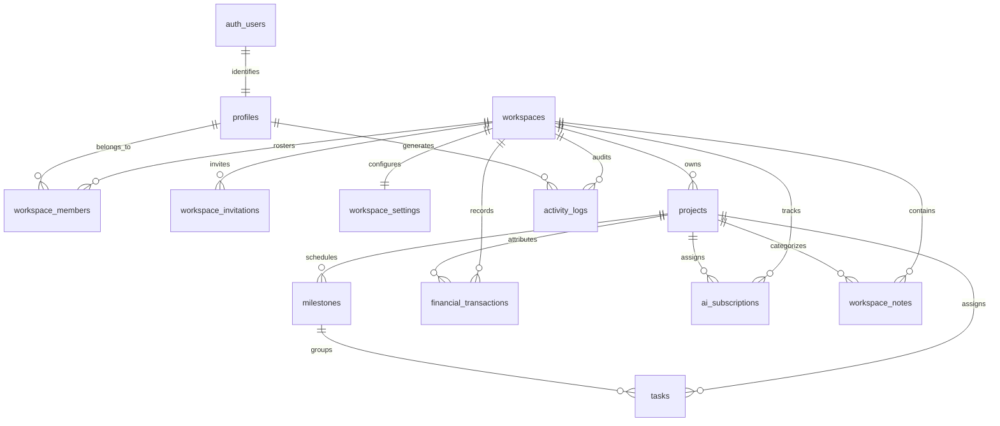

# Khai Space Hub — Normalized PostgreSQL Database Schema
**Document Version:** 1.0.0  
**Phase:** Phase 3 Architecture & Persistence Planning  
**Application Target:** `apps/hub/`  
**Working Branch:** `feature/khai-space-hub`  
**Repository:** `khairultajudin/khaispace`

---

## 1. Schema Design Philosophy

The Khai Space Hub schema is engineered to production standards of relational normalization, data integrity, and strict multi-tenant isolation:

1. **UUIDv4 Primary Keys:** All tables use `uuid` primary keys generated by `gen_random_uuid()` to eliminate sequential enumeration vulnerabilities.
2. **Universal Workspace Scoping:** Every entity belonging to a workspace includes a mandatory `workspace_id uuid NOT NULL REFERENCES workspaces(id) ON DELETE CASCADE`.
3. **Exact Decimal Monetary Representation:** All financial currencies are stored as `numeric(12, 2)`. Floating-point types (`float`, `real`, `double precision`) are strictly prohibited to prevent decimal rounding anomalies.
4. **Calendar Date vs Instant Separation:**
   - Calendar-only dates (e.g. task due dates, subscription billing dates, transaction dates) are stored as PostgreSQL `date` (`YYYY-MM-DD`).
   - Timestamps representing exact points in time (audit trails, creation/update instants) are stored as `timestamptz` in UTC.
5. **Strict Constraint Defense:** Data validity is enforced at the database layer using `CHECK` constraints, `NOT NULL` rules, and foreign key cascades.
6. **Automatic Timestamp Maintenance:** All mutable tables implement a trigger executing `moddatetime()` to guarantee `updated_at` accuracy.

---

## 2. Mermaid Entity-Relationship Diagram (ERD)



---

## 3. Custom PostgreSQL Enums & Types

```sql
CREATE TYPE project_status AS ENUM (
  'Active',
  'Production',
  'In Development',
  'Planning',
  'Documented'
);

CREATE TYPE task_priority AS ENUM (
  'High',
  'Medium',
  'Normal'
);

CREATE TYPE task_status AS ENUM (
  'In Progress',
  'Pending',
  'Completed'
);

CREATE TYPE milestone_status AS ENUM (
  'Planned',
  'In Progress',
  'Completed'
);

CREATE TYPE transaction_type AS ENUM (
  'Income',
  'Expense',
  'Investment'
);

CREATE TYPE subscription_status AS ENUM (
  'Active',
  'Paused',
  'Cancelled',
  'Trial'
);

CREATE TYPE billing_cycle AS ENUM (
  'Monthly',
  'Annual'
);

CREATE TYPE note_record_type AS ENUM (
  'Note',
  'Decision'
);

CREATE TYPE decision_status AS ENUM (
  'Proposed',
  'Approved',
  'Rejected',
  'Superseded'
);

CREATE TYPE member_role AS ENUM (
  'Owner',
  'Administrator',
  'Member',
  'Viewer'
);

CREATE TYPE member_status AS ENUM (
  'Active',
  'Pending',
  'Suspended'
);
```

---

## 4. Comprehensive Table Specifications

### 4.1 `workspaces` (Tenant Boundary)
- **Purpose:** Represents the top-level organizational boundary for all projects, records, finances, and roster members.
- **Columns:**

| Column | Type | Nullable | Default | Constraints & Description |
|:---|:---|:---:|:---:|:---|
| `id` | `uuid` | No | `gen_random_uuid()` | Primary Key |
| `name` | `varchar(100)` | No | | Display name (`Khai Space Command Center`) |
| `description` | `text` | No | `''` | Mission statement / workspace summary |
| `timezone` | `varchar(50)` | No | `'Asia/Kuala_Lumpur (GMT+8)'` | Operating timezone |
| `default_currency` | `varchar(10)` | No | `'MYR (RM)'` | Monetary standard |
| `date_format` | `varchar(20)` | No | `'YYYY-MM-DD'` | Calendar presentation standard |
| `content_density` | `varchar(20)` | No | `'comfortable'` | Default layout preference (`comfortable` / `compact`) |
| `created_at` | `timestamptz` | No | `now()` | Inception timestamp |
| `updated_at` | `timestamptz` | No | `now()` | Last modification instant |
| `created_by` | `uuid` | Yes | `auth.uid()` | FK to `auth.users(id)` |

- **Indexes:** None (root table, filtered by PK).
- **Deletion Policy:** Restricted. Cannot be deleted while active members exist.

---

### 4.2 `profiles` (User Identity)
- **Purpose:** Stores public and collaborative user profile details linked directly to Supabase Auth.
- **Columns:**

| Column | Type | Nullable | Default | Constraints & Description |
|:---|:---|:---:|:---:|:---|
| `id` | `uuid` | No | | Primary Key, `REFERENCES auth.users(id) ON DELETE CASCADE` |
| `full_name` | `varchar(100)` | No | | Legal / display full name |
| `display_name` | `varchar(50)` | No | | Preferred callsign / handle |
| `email` | `varchar(255)` | No | | Unique email, matches `auth.users.email` |
| `bio` | `text` | No | `''` | Professional background and engineering focus |
| `location` | `varchar(100)` | No | `'Kuala Lumpur, Malaysia'` | Physical base |
| `timezone` | `varchar(50)` | No | `'Asia/Kuala_Lumpur (GMT+8)'` | User local timezone |
| `avatar_initials` | `varchar(4)` | No | `'KT'` | 2-letter uppercase initials |
| `created_at` | `timestamptz` | No | `now()` | Profile creation timestamp |
| `updated_at` | `timestamptz` | No | `now()` | Profile last modified timestamp |

- **Indexes:** `CREATE UNIQUE INDEX idx_profiles_email ON profiles(email);`
- **Deletion Policy:** Cascades when an `auth.users` record is purged.

---

### 4.3 `workspace_members` (Roster & RBAC)
- **Purpose:** Associates user profiles with workspaces, assigning role-based permissions and access statuses.
- **Columns:**

| Column | Type | Nullable | Default | Constraints & Description |
|:---|:---|:---:|:---:|:---|
| `id` | `uuid` | No | `gen_random_uuid()` | Primary Key |
| `workspace_id` | `uuid` | No | | `REFERENCES workspaces(id) ON DELETE CASCADE` |
| `user_id` | `uuid` | No | | `REFERENCES profiles(id) ON DELETE CASCADE` |
| `role` | `member_role` | No | `'Member'` | RBAC permission level |
| `status` | `member_status`| No | `'Active'` | Account access status |
| `bio` | `text` | Yes | `NULL` | Role-specific title/responsibilities in this workspace |
| `invited_by` | `uuid` | Yes | | `REFERENCES profiles(id) ON DELETE SET NULL` |
| `joined_at` | `timestamptz` | No | `now()` | Date joined |
| `created_at` | `timestamptz` | No | `now()` | Inception instant |
| `updated_at` | `timestamptz` | No | `now()` | Last status change instant |

- **Constraints:** `UNIQUE(workspace_id, user_id)`
- **Owner Protection Rule:** An explicit database trigger prevents removing or demoting the last `Owner` in a workspace.
- **Indexes:**
  - `CREATE INDEX idx_workspace_members_user ON workspace_members(user_id);`
  - `CREATE INDEX idx_workspace_members_lookup ON workspace_members(workspace_id, user_id, status);`

---

### 4.4 `workspace_invitations` (Future Invite Management)
- **Purpose:** Securely manages pending invitations for new collaborators (e.g. Khai's wife) before account creation.
- **Columns:**

| Column | Type | Nullable | Default | Constraints & Description |
|:---|:---|:---:|:---:|:---|
| `id` | `uuid` | No | `gen_random_uuid()` | Primary Key |
| `workspace_id` | `uuid` | No | | `REFERENCES workspaces(id) ON DELETE CASCADE` |
| `email` | `varchar(255)` | No | | Target invitee email |
| `role` | `member_role` | No | `'Member'` | Role assigned upon acceptance |
| `token_hash` | `text` | No | | SHA-256 hash of single-use secure invite token |
| `status` | `varchar(20)` | No | `'pending'` | `'pending'` \| `'accepted'` \| `'revoked'` \| `'expired'` |
| `personal_message` | `text` | Yes | | Custom note from inviter |
| `invited_by` | `uuid` | No | | `REFERENCES profiles(id) ON DELETE CASCADE` |
| `expires_at` | `timestamptz` | No | | Expiration timestamp (e.g. `now() + interval '7 days'`) |
| `created_at` | `timestamptz` | No | `now()` | Dispatch timestamp |

- **Constraints:** `UNIQUE(workspace_id, email, status)` for pending invites.
- **Indexes:** `CREATE INDEX idx_invitations_token ON workspace_invitations(token_hash);`

---

### 4.5 `workspace_settings` (Configuration & Notification Flags)
- **Purpose:** Stores the 5 workspace-level event simulation/notification channels.
- **Columns:**

| Column | Type | Nullable | Default | Constraints & Description |
|:---|:---|:---:|:---:|:---|
| `workspace_id` | `uuid` | No | | Primary Key, `REFERENCES workspaces(id) ON DELETE CASCADE` |
| `notification_task_reminders` | `boolean` | No | `true` | Task due date reminders |
| `notification_milestone_updates` | `boolean` | No | `true` | Milestone 100% completion alerts |
| `notification_project_updates` | `boolean` | No | `true` | Project status transition alerts |
| `notification_workspace_activity` | `boolean`| No | `false`| Roster invitation & role changes |
| `notification_subscription_renewals`| `boolean`| No | `true` | 30-day upcoming subscription renewals |
| `updated_at` | `timestamptz` | No | `now()` | Last modification instant |

---

### 4.6 `projects` (Engineering Projects Catalog)
- **Purpose:** Central entity for tracking internal repositories, physical hardware builds, and web services.
- **Columns:**

| Column | Type | Nullable | Default | Constraints & Description |
|:---|:---|:---:|:---:|:---|
| `id` | `varchar(50)` | No | | Primary Key (slug: `biztrack`, `smart-agro-telemetry`, etc.) |
| `workspace_id` | `uuid` | No | | `REFERENCES workspaces(id) ON DELETE CASCADE` |
| `title` | `varchar(150)` | No | | Human-readable title |
| `category` | `varchar(100)` | No | | Engineering classification |
| `status` | `project_status` | No | `'Planning'` | Lifecycle execution status |
| `location` | `varchar(200)` | No | | Codebase directory path |
| `description` | `text` | No | | Single-sentence architectural summary |
| `full_description` | `text` | Yes | `NULL` | Detailed markdown documentation |
| `tags` | `text[]` | No | `'{}'` | Categorical tags array |
| `metadata` | `jsonb` | No | `'{}'::jsonb`| Scope, techStack, verificationStatus JSON |
| `created_at` | `timestamptz` | No | `now()` | Inception instant |
| `updated_at` | `timestamptz` | No | `now()` | Last modified instant |
| `created_by` | `uuid` | Yes | | `REFERENCES profiles(id) ON DELETE SET NULL` |

- **Indexes:**
  - `CREATE INDEX idx_projects_workspace ON projects(workspace_id);`
  - `CREATE INDEX idx_projects_status ON projects(workspace_id, status);`
- **Deletion Policy:** Soft deletion or archiving recommended. Hard deletion cascades to tasks and milestones, but preserves financial ledger records via `SET NULL`.

---

### 4.7 `milestones` (Project Milestones)
- **Purpose:** High-level project deliverables grouping related execution tasks.
- **Columns:**

| Column | Type | Nullable | Default | Constraints & Description |
|:---|:---|:---:|:---:|:---|
| `id` | `varchar(50)` | No | | Primary Key (slug: `ms-clicker-mvp`, etc.) |
| `workspace_id` | `uuid` | No | | `REFERENCES workspaces(id) ON DELETE CASCADE` |
| `project_id` | `varchar(50)` | No | | `REFERENCES projects(id) ON DELETE CASCADE` |
| `title` | `varchar(150)` | No | | Milestone title |
| `target_date` | `date` | No | | Calendar target completion date (`YYYY-MM-DD`) |
| `status` | `milestone_status` | No | `'Planned'`| Execution state |
| `description` | `text` | No | `''` | Acceptance criteria |
| `created_at` | `timestamptz` | No | `now()` | Inception instant |
| `updated_at` | `timestamptz` | No | `now()` | Last modified instant |
| `created_by` | `uuid` | Yes | | `REFERENCES profiles(id) ON DELETE SET NULL` |

- **Indexes:**
  - `CREATE INDEX idx_milestones_project ON milestones(workspace_id, project_id);`
  - `CREATE INDEX idx_milestones_date ON milestones(workspace_id, target_date);`

---

### 4.8 `tasks` (Actionable Work Items)
- **Purpose:** Discrete action items with due dates, priority tiers, and milestone associations.
- **Columns:**

| Column | Type | Nullable | Default | Constraints & Description |
|:---|:---|:---:|:---:|:---|
| `id` | `varchar(50)` | No | | Primary Key (`task-1`, `task-2`, or UUID) |
| `workspace_id` | `uuid` | No | | `REFERENCES workspaces(id) ON DELETE CASCADE` |
| `project_id` | `varchar(50)` | No | | `REFERENCES projects(id) ON DELETE CASCADE` |
| `milestone_id` | `varchar(50)` | Yes | `NULL` | `REFERENCES milestones(id) ON DELETE SET NULL` |
| `title` | `varchar(200)` | No | | Actionable task headline |
| `priority` | `task_priority` | No | `'Normal'` | Urgency tier |
| `status` | `task_status` | No | `'Pending'`| Workflow state |
| `due_date` | `date` | No | | ISO calendar date (`YYYY-MM-DD`) |
| `description` | `text` | No | `''` | Detailed task instructions |
| `created_at` | `timestamptz` | No | `now()` | Inception instant |
| `updated_at` | `timestamptz` | No | `now()` | Last modified instant |
| `created_by` | `uuid` | Yes | | `REFERENCES profiles(id) ON DELETE SET NULL` |

- **Indexes:**
  - `CREATE INDEX idx_tasks_project ON tasks(workspace_id, project_id);`
  - `CREATE INDEX idx_tasks_status ON tasks(workspace_id, status);`
  - `CREATE INDEX idx_tasks_due_date ON tasks(workspace_id, due_date);`
  - `CREATE INDEX idx_tasks_milestone ON tasks(milestone_id);`

---

### 4.9 `financial_transactions` (Ledger Entries & ROI)
- **Purpose:** Tracks capital investments, operating expenses, and operational revenues with strict decimal accuracy.
- **Columns:**

| Column | Type | Nullable | Default | Constraints & Description |
|:---|:---|:---:|:---:|:---|
| `id` | `varchar(50)` | No | | Primary Key (`tx-01`, etc. or UUID) |
| `workspace_id` | `uuid` | No | | `REFERENCES workspaces(id) ON DELETE CASCADE` |
| `project_id` | `varchar(50)` | Yes | `NULL` | `REFERENCES projects(id) ON DELETE SET NULL` |
| `transaction_date`| `date` | No | | ISO calendar date (`YYYY-MM-DD`) |
| `type` | `transaction_type`| No | | `'Income'` \| `'Expense'` \| `'Investment'` |
| `category` | `varchar(100)` | No | | Accounting classification tag |
| `amount` | `numeric(12,2)`| No | | Non-negative monetary value in MYR |
| `description` | `text` | No | | Invoice narration / transaction title |
| `notes` | `text` | Yes | `NULL` | Accounting audit trail or vendor notes |
| `is_investment_return`| `boolean`| No | `false`| Strict certification for realized ROI |
| `created_at` | `timestamptz` | No | `now()` | Entry creation instant |
| `updated_at` | `timestamptz` | No | `now()` | Last modified instant |
| `created_by` | `uuid` | Yes | | `REFERENCES profiles(id) ON DELETE SET NULL` |

- **Constraints:**
  - `CHECK (amount > 0)`: Negative values prohibited (signs are determined by `type`).
  - `CHECK (type = 'Income' OR is_investment_return = false)`: Expenses and investments can never be tagged as investment returns.
- **Deletion Policy:** `ON DELETE SET NULL` for `project_id`. Financial records are permanent ledger entries; deleting a project must never delete historical financial data.
- **Indexes:**
  - `CREATE INDEX idx_tx_workspace_date ON financial_transactions(workspace_id, transaction_date DESC);`
  - `CREATE INDEX idx_tx_project ON financial_transactions(workspace_id, project_id);`
  - `CREATE INDEX idx_tx_roi_lookup ON financial_transactions(workspace_id, type, is_investment_return);`

---

### 4.10 `ai_subscriptions` (AI Tools & Recurring Commitments)
- **Purpose:** Manages active, paused, and trial AI tool licenses, tracking renewal cycles and cost forecasts.
- **Columns:**

| Column | Type | Nullable | Default | Constraints & Description |
|:---|:---|:---:|:---:|:---|
| `id` | `varchar(50)` | No | | Primary Key (`sub-01`, etc. or UUID) |
| `workspace_id` | `uuid` | No | | `REFERENCES workspaces(id) ON DELETE CASCADE` |
| `assigned_project_id`| `varchar(50)`| Yes | `NULL` | `REFERENCES projects(id) ON DELETE SET NULL` |
| `provider` | `varchar(100)` | No | | Vendor name (`Anthropic`, `OpenAI`) |
| `product_name` | `varchar(100)` | No | | Tool name (`Claude Pro`, `Cursor Pro`) |
| `plan_name` | `varchar(100)` | No | | Plan tier (`Pro Tier`, `Standard`) |
| `category` | `varchar(100)` | No | | Functional domain |
| `billing_cycle` | `billing_cycle`| No | `'Monthly'` | `'Monthly'` \| `'Annual'` |
| `amount` | `numeric(12,2)`| No | | License cost in MYR |
| `currency` | `varchar(3)` | No | `'MYR'` | Fixed ISO currency code |
| `status` | `subscription_status`| No | `'Active'` | Account status |
| `start_date` | `date` | No | | Inception date |
| `next_billing_date`| `date` | No | | Upcoming renewal date |
| `purpose` | `text` | No | | Functional business justification |
| `notes` | `text` | Yes | `NULL` | Seat allocations or cancellation terms |
| `created_at` | `timestamptz` | No | `now()` | Entry creation instant |
| `updated_at` | `timestamptz` | No | `now()` | Last modified instant |
| `created_by` | `uuid` | Yes | | `REFERENCES profiles(id) ON DELETE SET NULL` |

- **Constraints:**
  - `CHECK (amount >= 0)`
  - `CHECK (currency = 'MYR')`
- **Zero Ledger Coupling:** Records in this table do NOT automatically write into `financial_transactions`.
- **Indexes:**
  - `CREATE INDEX idx_subs_workspace_status ON ai_subscriptions(workspace_id, status);`
  - `CREATE INDEX idx_subs_renewal ON ai_subscriptions(workspace_id, next_billing_date);`

---

### 4.11 `workspace_notes` (Knowledge Base & ADRs)
- **Purpose:** Stores project notes, reference guides, and documented Architectural Decision Records (ADRs).
- **Columns:**

| Column | Type | Nullable | Default | Constraints & Description |
|:---|:---|:---:|:---:|:---|
| `id` | `varchar(50)` | No | | Primary Key (`note-1`, `dec-1`, etc. or UUID) |
| `workspace_id` | `uuid` | No | | `REFERENCES workspaces(id) ON DELETE CASCADE` |
| `project_id` | `varchar(50)` | Yes | `NULL` | `REFERENCES projects(id) ON DELETE SET NULL` |
| `type` | `note_record_type`| No | `'Note'` | `'Note'` \| `'Decision'` |
| `title` | `varchar(200)` | No | | Document headline |
| `content` | `text` | No | | Markdown document body |
| `category` | `varchar(100)` | No | | Classification tag |
| `tags` | `text[]` | No | `'{}'` | Categorical tags |
| `decision_status` | `decision_status`| Yes | `NULL` | Status if `type = 'Decision'` |
| `rationale` | `text` | Yes | `NULL` | Architectural/business justification |
| `impact` | `text` | Yes | `NULL` | Downstream impact analysis |
| `created_at` | `timestamptz` | No | `now()` | Document creation instant |
| `updated_at` | `timestamptz` | No | `now()` | Document last modified instant |
| `created_by` | `uuid` | Yes | | `REFERENCES profiles(id) ON DELETE SET NULL` |

- **Constraints:**
  - `CHECK ((type = 'Decision' AND decision_status IS NOT NULL) OR (type = 'Note' AND decision_status IS NULL))`
- **Type Immutability:** Enforced via a database trigger preventing `type` from changing once created.
- **Indexes:**
  - `CREATE INDEX idx_notes_workspace_type ON workspace_notes(workspace_id, type);`
  - `CREATE INDEX idx_notes_project ON workspace_notes(workspace_id, project_id);`

---

### 4.12 `activity_logs` (Audit Trail)
- **Purpose:** Immutable event log tracking significant actions across all Hub modules.
- **Columns:**

| Column | Type | Nullable | Default | Constraints & Description |
|:---|:---|:---:|:---:|:---|
| `id` | `uuid` | No | `gen_random_uuid()` | Primary Key |
| `workspace_id` | `uuid` | No | | `REFERENCES workspaces(id) ON DELETE CASCADE` |
| `user_id` | `uuid` | Yes | | `REFERENCES profiles(id) ON DELETE SET NULL` |
| `action` | `varchar(255)` | No | | Action summary narration |
| `entity_type` | `varchar(50)` | No | | Target entity (`project`, `task`, `transaction`, etc.) |
| `entity_id` | `varchar(50)` | No | | Target entity ID |
| `project_id` | `varchar(50)` | Yes | `NULL` | Related project slug if applicable |
| `category` | `varchar(50)` | No | | Event category (`Documentation`, `Finance`, `Roster`) |
| `metadata` | `jsonb` | No | `'{}'::jsonb`| Before/after delta or contextual payload |
| `created_at` | `timestamptz` | No | `now()` | Exact UTC event timestamp |

- **Indexes:** `CREATE INDEX idx_activity_workspace ON activity_logs(workspace_id, created_at DESC);`
- **Immutability:** RLS blocks `UPDATE` and `DELETE` on this table for all users.
