# Khai Space Hub — Persistence Implementation & Migration Roadmap
**Document Version:** 1.1.0 (Updated through Phase 5 Completion)
**Phase:** Phase 5 — Authentication Foundation & Private Workspace Access
**Application Target:** `apps/hub/`
**Working Branch:** `feature/khai-space-hub`
**Repository:** `khairultajudin/khaispace`

---

## 1. Roadmap Overview & Phased Migration Strategy

Moving Khai Space Hub from in-memory React session state to a persistent, production-grade Supabase architecture requires a controlled, phased migration.

### Core Migration Principles
1. **Zero Downtime / Zero Regressions:** Existing prototype functionality must remain operational at every step.
2. **Incremental Adoption:** Entities are migrated module by module with automated quality gates between phases.
3. **Manual Approval Gates:** Phases involving external project provisioning, DNS/Auth changes, or database schema deployment require explicit stakeholder review and approval.
4. **Scope Control:** Each phase executes strictly within its approved boundaries; Phase 6 (Schema & RLS Deployment) and Phases 7–10 remain gated pending explicit project owner approval.

```mermaid
flowchart LR
    P3["Phase 3: Architecture Planning (Completed)"] --> P4["Phase 4 & 4.1: Supabase Foundation & Types (Completed)"]
    P4 --> P5["Phase 5: Auth & Workspace Access (Completed)"]
    P5 --> P6["Phase 6: Schema & RLS Deployment (Next)"]
    P6 --> P7["Phase 7: Core Persistence (Projects, Tasks, Notes)"]
    P7 --> P8["Phase 8: Finance & Subscriptions"]
    P8 --> P9["Phase 9: Members & Settings"]
    P9 --> P10["Phase 10: Production Hardening & Launch"]
```

---

## 2. Phase-by-Phase Implementation Specifications

### Phase 4 & 4.1 — Supabase Foundation, Client Setup & Type Integrity (Completed)
- **Status:** **COMPLETED** (See [`PHASE-4-SUPABASE-FOUNDATION-REPORT.md`](file:///e:/KhaiSpace/apps/hub/docs/architecture/PHASE-4-SUPABASE-FOUNDATION-REPORT.md) and [`PHASE-4.1-TYPE-INTEGRITY-CORRECTION-REPORT.md`](file:///e:/KhaiSpace/apps/hub/docs/architecture/PHASE-4.1-TYPE-INTEGRITY-CORRECTION-REPORT.md))
- **Objective:** Provision a dedicated Supabase project, install official SDK packages, configure typed client wrappers, and reconcile 1:1 TypeScript database definitions against `schema-draft.sql` without touching existing UI components.
- **Dependencies:** Completion and approval of Phase 3 architecture deliverables.
- **Completed Deliverables:**
  1. Provisioned dedicated Supabase project `khai-space-hub` (`dpicdhjaabfjbvppmsxk`, region `ap-southeast-1` Singapore).
  2. Installed `@supabase/supabase-js` and created `apps/hub/src/lib/supabase/client.ts` with isolated `khaispace-hub-auth` storage key.
  3. Created and reconciled `apps/hub/src/types/database.types.ts` 1:1 with `schema-draft.sql`.
  4. Verified static export compatibility (`next build` succeeds).

---

### Phase 5 — Authentication & Private Workspace Access (Completed)
- **Status:** **COMPLETED** (See [`PHASE-5-AUTHENTICATION-IMPLEMENTATION-REPORT.md`](file:///e:/KhaiSpace/apps/hub/docs/architecture/PHASE-5-AUTHENTICATION-IMPLEMENTATION-REPORT.md))
- **Objective:** Implement passwordless Magic Link and Email OTP authentication, private workspace gating, and secure client session management compatible with static export.
- **Dependencies:** Phase 4 & Phase 4.1.
- **Manual Stakeholder / Supabase Dashboard Actions (Required Before Live Email Testing):**
  1. In Supabase Dashboard -> Authentication -> Providers: Confirm **Email (Magic Link / OTP)** is enabled.
  2. In Supabase Dashboard -> Authentication -> URL Configuration: Configure Site URL (`https://hub.khaispace.com`) and Redirect URLs (`http://localhost:3000/auth/callback`, `https://hub.khaispace.com/auth/callback`).
  3. In Supabase Dashboard -> Authentication -> Users: Provision the initial Owner email account prior to first sign-in.
- **Completed Code Deliverables in `apps/hub/`:**
  - Created `apps/hub/src/lib/supabase/auth-service.ts` enforcing `shouldCreateUser: false`, open-redirect protection, token redaction, and account-enumeration protection.
  - Created `apps/hub/src/hooks/use-auth.ts` (`AuthProvider` & `useAuth`) tracking active Supabase session and explicit `workspaceAccessStatus` boundary (`authenticated_membership_unverified_phase_6`).
  - Created private `LoginView` (`apps/hub/src/components/auth/login-view.tsx`) and static `/login` route (`apps/hub/src/app/login/page.tsx`).
  - Created client callback handler (`apps/hub/src/components/auth/auth-callback-view.tsx`) and static `/auth/callback` route (`apps/hub/src/app/auth/callback/page.tsx`).
  - Created `AuthGuard` (`apps/hub/src/components/auth/auth-guard.tsx`) and integrated authenticated identity + Sign Out controls into `Header` and `Sidebar`.
- **Architectural Boundary Note:** Phase 5 verifies Supabase user authentication (`auth.users`). Database-backed workspace membership (`public.workspace_members`) and role authorization (`Owner` / `Admin` / `Collaborator` / `Viewer`) are enforced in Phase 6 once `schema-draft.sql` is deployed.

---

### Phase 6 — Database Schema & Row Level Security Deployment
- **Objective:** Apply reviewed PostgreSQL schema (v1.2.0 finalized), composite integrity triggers, anti-escalation policies, security-invoker views, invitation functions, and updated-at triggers to the dedicated Supabase project.
- **Dependencies:** Phase 5.
- **Manual Stakeholder / Supabase Dashboard Actions:**
  1. Open Supabase Dashboard -> SQL Editor (or link Supabase CLI).
  2. Execute the finalized `schema-draft.sql`.
  3. Confirm that:
     - All 12 tables, custom enums, and indexes are created.
     - Single-owner partial index `idx_workspace_single_owner` is active.
     - Tasks milestone foreign key uses `ON DELETE SET NULL (milestone_id)` with `handle_milestone_deletion_cleanup()`.
     - Optional project references across transactions, subscriptions, and notes are protected by integrity triggers.
     - Workspace deletion authorization trigger (`handle_workspace_deletion_authorization()`) and Owner protection trigger (`protect_workspace_owner()`) are verified.
     - Membership immutability trigger (`protect_workspace_members_immutability()`) is active.
     - Direct client `INSERT` on `workspaces`, `workspace_members`, and `activity_logs` is disabled; trusted procedures are installed.
     - All 10 `handle_updated_at()` triggers are active.
     - The 3 financial views have `security_invoker = true`.
- **Code Changes in `apps/hub/`:**
  - Run `supabase gen types typescript` to refresh `database.types.ts`.
  - Create automated integration tests verifying that RLS isolates workspaces, blocks suspended users, and prevents Administrators from self-promoting to Owner.
- **Exit Criteria:** Zero cross-workspace data leakage; Owner protection and anti-privilege escalation triggers pass all test suites.

---

### Phase 7 — Core Data Persistence (Projects, Tasks, Notes)
- **Objective:** Connect Projects, Tasks, Milestones, and Notes & Decisions modules to PostgreSQL.
- **Dependencies:** Phase 6.
- **Code Changes in `apps/hub/`:**
  - Implement `projects-service.ts`, `tasks-service.ts`, `notes-service.ts`.
  - Refactor `ProjectsView`, `TasksView`, and `NotesView` to read from services with optimistic UI updates.
  - Connect deep links (`#project-<id>`, `#task-<id>`, `#note-<id>`, `#decision-<id>`) to database queries.
  - Implement empty state views for brand-new workspaces.
- **Exit Criteria:** Projects, tasks, milestones, notes, and decisions persist across page reloads and update in real-time.

---

### Phase 8 — Financial Ledger & AI Subscriptions Persistence
- **Objective:** Connect Finance & ROI and AI Subscriptions modules to the database, enforcing exact decimal accuracy and strict investment return rules.
- **Dependencies:** Phase 7.
- **Code Changes in `apps/hub/`:**
  - Implement `finance-service.ts` querying `financial_transactions`, `view_overall_finance_kpis`, `view_project_finance_summary`, and `view_monthly_financial_trends`.
  - Implement `subscriptions-service.ts` querying `ai_subscriptions`.
  - Refactor `FinanceView` and `SubscriptionsView` to utilize database queries.
  - Verify that realized ROI only counts `is_investment_return === true`.
  - Verify that AI subscriptions do not automatically post to the general ledger.
- **Exit Criteria:** Financial summaries match mathematical ground truth; zero floating-point rounding errors; all 6 quality gates pass.

---

### Phase 9 — Members & Workspace Settings Persistence
- **Objective:** Persist owner profile, collaborator roster, workspace settings, and notification preferences.
- **Dependencies:** Phase 8.
- **Code Changes in `apps/hub/`:**
  - Implement `members-service.ts` and `settings-service.ts`.
  - Refactor `SettingsView`, `ProfileSettings`, and `WorkspaceSettingsView` to read from and write to database tables.
  - Restrict "Reset Baseline" button to local development demo mode (`NEXT_PUBLIC_ENABLE_DEMO_SEED === 'true'`).
  - Implement collaborator invitation workflow via Supabase Edge Function (`invite-member`).
- **Exit Criteria:** Profile changes update `profiles` and sync Owner card; workspace name/description updates persist; collaborator status toggles (Active/Suspended) enforce immediate access revocation.

---

### Phase 10 — Production Hardening, Audit & Handover
- **Objective:** Perform security audits, establish automated database backups, configure monitoring, and complete operational handover.
- **Dependencies:** Phase 9.
- **Manual Stakeholder / Supabase Dashboard Actions:**
  1. Verify daily automated database backups and Point-In-Time Recovery (PITR).
  2. Configure Cloudflare DNS CNAME pointing `hub.khaispace.com` to the production static deployment.
  3. Conduct penetration test verifying zero unauthorized data access.
- **Code Changes in `apps/hub/`:**
  - Run full quality gates: Hub typecheck, Hub lint, Hub build, Root typecheck, Root lint, Root build.
  - Final documentation update and user training guide.
- **Exit Criteria:** All security checks pass; production build succeeds in < 5 seconds; Hub is fully operational on `hub.khaispace.com`.

---

## 3. Risk Matrix & Rollback Protocols

| Migration Phase | Primary Risk | Mitigation & Rollback Protocol |
|:---|:---|:---|
| **Phase 4: Client Setup** | Bundle size increase / static export breakage | Verify `next build` static export on every PR. Rollback: remove package dependencies. |
| **Phase 5: Auth Gating** | User lockout or email delivery failure | Maintain local fallback session bypass in development. Rollback: disable auth guard flag in environment. |
| **Phase 6: Schema & RLS** | Recursive policy timeout or permission denial | Thorough static SQL review; execute `DROP POLICY` and re-apply corrected definitions via migration scripts. |
| **Phase 7: Core Persistence** | Data corruption / UI render latency | Use optimistic UI updates with error rollback toasts; maintain sample data fallback on network failure. |
| **Phase 8: Finance Ledger** | Inaccurate ROI calculation or cashflow discrepancy | Compare database view output against existing TypeScript `finance-utils.ts` test fixtures down to the exact cent. |
| **Phase 9: Settings Sync** | Accidental Owner demotion or removal | Protected at PostgreSQL engine level via `protect_workspace_owner()` trigger. |
