# Khai Space Hub — Persistence Implementation & Migration Roadmap
**Document Version:** 1.0.0  
**Phase:** Phase 3 Architecture & Persistence Planning  
**Application Target:** `apps/hub/`  
**Working Branch:** `feature/khai-space-hub`  
**Repository:** `khairultajudin/khaispace`

---

## 1. Roadmap Overview & Phased Migration Strategy

Moving Khai Space Hub from in-memory React session state to a persistent, production-grade Supabase architecture requires a controlled, phased migration. 

### Core Migration Principles
1. **Zero Downtime / Zero Regressions:** Existing prototype functionality must remain operational at every step.
2. **Incremental Adoption:** Entities are migrated module by module with automated quality gates between phases.
3. **Manual Approval Gates:** Phases involving external project provisioning, DNS/Auth changes, or database schema deployment require explicit stakeholder review and approval.
4. **Scope Control:** **Phase 3 plans the architecture; it does not execute any of the future phases below.**

```mermaid
flowchart LR
    P3["Phase 3: Architecture Planning (Current)"] --> P4["Phase 4: Supabase Foundation"]
    P4 --> P5["Phase 5: Auth & Workspace Access"]
    P5 --> P6["Phase 6: Schema & RLS Deployment"]
    P6 --> P7["Phase 7: Core Persistence (Projects, Tasks, Notes)"]
    P7 --> P8["Phase 8: Finance & Subscriptions"]
    P8 --> P9["Phase 9: Members & Settings"]
    P9 --> P10["Phase 10: Production Hardening & Launch"]
```

---

## 2. Phase-by-Phase Implementation Specifications

### Phase 4 — Supabase Foundation & Client Setup
- **Objective:** Provision a dedicated Supabase project, install official SDK packages, and configure typed client wrappers without touching existing UI components.
- **Dependencies:** Completion and approval of Phase 3 architecture deliverables.
- **Manual Stakeholder / Supabase Dashboard Actions:**
  1. Create a new, isolated Supabase project named `khai-space-hub` (do not reuse BizTrack).
  2. Retrieve the Project URL and Public Anon Key.
  3. Set up local development environment secrets in `.env.local` (untracked in git).
- **Code Changes in `apps/hub/`:**
  - Install dependencies: `@supabase/supabase-js`, `@supabase/ssr`.
  - Create `apps/hub/src/lib/supabase/client.ts`.
  - Create TypeScript database types file `apps/hub/src/types/database.types.ts`.
  - Verify static export compatibility (`next build` succeeds).
- **Exit Criteria:** Automated test script confirms successful connection to Supabase via `anon` key from local development environment.

---

### Phase 5 — Authentication & Private Workspace Access
- **Objective:** Implement passwordless Magic Link authentication, private workspace gating, and secure session management.
- **Dependencies:** Phase 4.
- **Manual Stakeholder / Supabase Dashboard Actions:**
  1. In Supabase Dashboard -> Authentication -> Providers: Enable **Email (Magic Link / OTP)**.
  2. In Supabase Dashboard -> Authentication -> Settings: **Disable "Allow new users to sign up" (Public Signup Disabled)**.
  3. Configure Site URL to `https://hub.khaispace.com` and development redirect `http://localhost:3001`.
- **Code Changes in `apps/hub/`:**
  - Implement login modal / view for Khai and invited collaborators.
  - Create `useAuth` hook tracking active Supabase session.
  - Implement authentication guard: unauthenticated users see the Login view; authenticated users enter the Hub.
  - Store session in memory / local storage using Supabase Auth helpers.
- **Exit Criteria:** Khai can log in via email OTP; uninvited public emails are rejected; session persists across browser refreshes.

---

### Phase 6 — Database Schema & Row Level Security Deployment
- **Objective:** Apply reviewed PostgreSQL schema (v1.1.0 hardened), composite integrity triggers, anti-escalation policies, security-invoker views, and updated-at triggers to the dedicated Supabase project.
- **Dependencies:** Phase 5.
- **Manual Stakeholder / Supabase Dashboard Actions:**
  1. Open Supabase Dashboard -> SQL Editor (or link Supabase CLI).
  2. Execute the finalized `schema-draft.sql`.
  3. Confirm that:
     - All 12 tables and custom enums are created.
     - Single-owner partial index `idx_workspace_single_owner` is active.
     - Composite integrity triggers and foreign keys are verified.
     - Anti-recursion helper functions are granted only to `authenticated`.
     - `protect_workspace_owner()` and `protect_activity_log_integrity()` triggers are installed.
     - All 10 `handle_updated_at()` triggers are active.
     - The 3 financial views have `security_invoker = true`.
- **Code Changes in `apps/hub/`:**
  - Run `supabase gen types typescript` to refresh `database.types.ts`.
  - Create automated integration tests verifying that RLS isolates workspaces, blocks suspended users, and prevents Administrators from self-promoting to Owner.
- **Exit Criteria:** Zero cross-workspace data leakage; Owner protection and anti-privilege escalation triggers pass all test suites.

---

### Phase 7 — Core Data Persistence (Projects, Tasks, Notes)
- **Objective:** Connect Projects, Tasks, Milestones, and Notes & Decisions modules to PostgreSQL.
- **Dependencies:** Phase 6.
- **Code Changes in `apps/hub/`:**
  - Implement `projects-service.ts`, `tasks-service.ts`, `notes-service.ts`.
  - Refactor `ProjectsView`, `TasksView`, and `NotesView` to read from services with optimistic UI updates.
  - Connect deep links (`#project-<id>`, `#task-<id>`, `#note-<id>`, `#decision-<id>`) to database queries.
  - Implement empty state views for brand-new workspaces.
- **Exit Criteria:** Projects, tasks, milestones, notes, and decisions persist across page reloads and update in real-time.

---

### Phase 8 — Financial Ledger & AI Subscriptions Persistence
- **Objective:** Connect Finance & ROI and AI Subscriptions modules to the database, enforcing exact decimal accuracy and strict investment return rules.
- **Dependencies:** Phase 7.
- **Code Changes in `apps/hub/`:**
  - Implement `finance-service.ts` querying `financial_transactions`, `view_overall_finance_kpis`, `view_project_finance_summary`, and `view_monthly_financial_trends`.
  - Implement `subscriptions-service.ts` querying `ai_subscriptions`.
  - Refactor `FinanceView` and `SubscriptionsView` to utilize database queries.
  - Verify that realized ROI only counts `is_investment_return === true`.
  - Verify that AI subscriptions do not automatically post to the general ledger.
- **Exit Criteria:** Financial summaries match mathematical ground truth; zero floating-point rounding errors; all 6 quality gates pass.

---

### Phase 9 — Members & Workspace Settings Persistence
- **Objective:** Persist owner profile, collaborator roster, workspace settings, and notification preferences.
- **Dependencies:** Phase 8.
- **Code Changes in `apps/hub/`:**
  - Implement `members-service.ts` and `settings-service.ts`.
  - Refactor `SettingsView`, `ProfileSettings`, and `WorkspaceSettingsView` to read from and write to database tables.
  - Restrict "Reset Baseline" button to local development demo mode (`NEXT_PUBLIC_ENABLE_DEMO_SEED === 'true'`).
  - Implement collaborator invitation workflow via Supabase Edge Function (`invite-member`).
- **Exit Criteria:** Profile changes update `profiles` and sync Owner card; workspace name/description updates persist; collaborator status toggles (Active/Suspended) enforce immediate access revocation.

---

### Phase 10 — Production Hardening, Audit & Handover
- **Objective:** Perform security audits, establish automated database backups, configure monitoring, and complete operational handover.
- **Dependencies:** Phase 9.
- **Manual Stakeholder / Supabase Dashboard Actions:**
  1. Verify daily automated database backups and Point-In-Time Recovery (PITR).
  2. Configure Cloudflare DNS CNAME pointing `hub.khaispace.com` to the production static deployment.
  3. Conduct penetration test verifying zero unauthorized data access.
- **Code Changes in `apps/hub/`:**
  - Run full quality gates: Hub typecheck, Hub lint, Hub build, Root typecheck, Root lint, Root build.
  - Final documentation update and user training guide.
- **Exit Criteria:** All security checks pass; production build succeeds in < 5 seconds; Hub is fully operational on `hub.khaispace.com`.

---

## 3. Risk Matrix & Rollback Protocols

| Migration Phase | Primary Risk | Mitigation & Rollback Protocol |
|:---|:---|:---|
| **Phase 4: Client Setup** | Bundle size increase / static export breakage | Verify `next build` static export on every PR. Rollback: remove package dependencies. |
| **Phase 5: Auth Gating** | User lockout or email delivery failure | Maintain local fallback session bypass in development. Rollback: disable auth guard flag in environment. |
| **Phase 6: Schema & RLS** | Recursive policy timeout or permission denial | Thorough static SQL review; execute `DROP POLICY` and re-apply corrected definitions via migration scripts. |
| **Phase 7: Core Persistence** | Data corruption / UI render latency | Use optimistic UI updates with error rollback toasts; maintain sample data fallback on network failure. |
| **Phase 8: Finance Ledger** | Inaccurate ROI calculation or cashflow discrepancy | Compare database view output against existing TypeScript `finance-utils.ts` test fixtures down to the exact cent. |
| **Phase 9: Settings Sync** | Accidental Owner demotion or removal | Protected at PostgreSQL engine level via `protect_workspace_owner()` trigger. |
