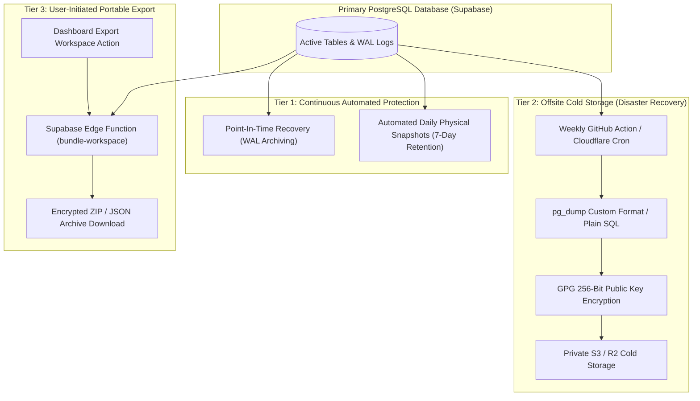

# Khai Space Hub — Operations, Backup & Maintenance Architecture
**Document Version:** 1.0.0  
**Phase:** Phase 3 Architecture & Persistence Planning  
**Application Target:** `apps/hub/`  
**Working Branch:** `feature/khai-space-hub`  
**Repository:** `khairultajudin/khaispace`

---

## 1. Operational Philosophy & Reliability Targets

As a private command center for engineering and business operations, Khai Space Hub must ensure:
1. **Zero Data Loss (RPO < 1 Hour):** Financial transactions, project decisions, and architectural notes must be recoverable to any recent minute.
2. **Rapid Recovery (RTO < 2 Hours):** In the event of catastrophic corruption or accidental deletion, full restoration must be achievable within two hours.
3. **Data Sovereignty & Portability:** The workspace Owner must have the ability to export all records into standard, unencumbered JSON/CSV formats at any time.
4. **Minimal Maintenance Overhead:** Operations rely on automated, serverless routines without requiring dedicated database administrator hours.

---

## 2. Comprehensive Backup & Disaster Recovery Strategy



### 2.1 Backup Tier Specifications

| Tier | Mechanism | Frequency | Retention | Recovery Objective |
|:---|:---|:---:|:---:|:---|
| **Tier 1: Continuous PITR** | Supabase Managed WAL Streaming | Continuous | 7 to 30 Days | Recover to exact second prior to accidental mutation |
| **Tier 2: Daily Physical Snapshot** | Managed Cloud Database Snapshot | Every 24 Hours | 30 Days | Restore full database cluster |
| **Tier 3: Encrypted Offsite Dump** | Automated `pg_dump` via GitHub Actions | Weekly | 90 Days | Disaster recovery independent of Supabase platform |
| **Tier 4: Portable Workspace Export** | On-demand JSON snapshot | On Demand | Indefinite (User-held) | Human-readable backup & local migration |

---

## 3. Database Migration Management

All schema updates must be version-controlled, reviewed, and applied through the Supabase CLI migration workflow:

```
apps/hub/supabase/
├── config.toml
├── migrations/
│   ├── 20261110000001_initial_hub_schema.sql
│   ├── 20261110000002_rls_security_policies.sql
│   ├── 20261110000003_accounting_kpi_views.sql
│   └── 20261110000004_owner_protection_trigger.sql
└── seed.sql
```

### Migration Rules
1. **Idempotence:** Every migration must be repeatable and wrapped in explicit transactions (`BEGIN ... COMMIT`).
2. **Zero In-Place Edits:** Never modify an applied migration file; create a new timestamped migration for changes.
3. **Pre-Production Testing:** Migrations must be verified in an isolated local Supabase container before execution on the staging or production database.

---

## 4. Immutable Audit Trail & Activity Logging

Significant workspace actions automatically generate records in `public.activity_logs`:

### 4.1 Logged Event Types
- **Security & Roster:** Collaborator invitations, status transitions (Suspended/Reactivated), role reassignments.
- **Projects & Decisions:** Project status shifts, architectural decision recordings (`Proposed`, `Approved`, `Rejected`, `Superseded`).
- **Financial Ledger:** Creation of transactions > RM 1,000, any transaction deletion (restricted to Admins/Owners).
- **Workspace Settings:** Configuration adjustments (timezone, name, notification toggles).

### 4.2 Security Constraints on `activity_logs`
- **Write Policy & Anti-Forgery:** Authenticated members can append (`INSERT`) audit records scoped to their `workspace_id`. The database trigger `protect_activity_log_integrity()` automatically overrides `user_id` with `auth.uid()` and `created_at` with server `now()`, preventing client impersonation or timestamp manipulation.
- **Read Policy:** Active workspace members can read (`SELECT`) logs scoped to their `workspace_id`.
- **Tamper Resistance:** `UPDATE` and `DELETE` operations are **permanently disabled via RLS**, guaranteeing an immutable historical ledger.

---

## 5. Performance Monitoring, Indexing & Query Health

### 5.1 Query Optimization
- Monitor query latency using PostgreSQL's built-in `pg_stat_statements`.
- High-frequency queries (dashboard overview metrics, project finance summaries) are backed by targeted composite indexes:
  - `idx_tx_roi_lookup` on `(workspace_id, type, is_investment_return)`
  - `idx_tasks_status` on `(workspace_id, status)`
  - `idx_subs_renewal` on `(workspace_id, next_billing_date)`

### 5.2 Routine Maintenance Schedule
- **Auto-Vacuuming:** Managed automatically by Supabase with default settings optimized for write-optimized transactional tables.
- **Connection Pooling:** PostgREST automatically utilizes built-in Supavisor connection pooling, eliminating connection exhaustion risks even under high client concurrency.
