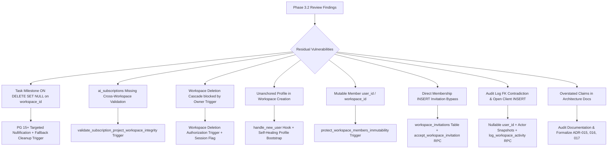

# Phase 3.2: Final Database Integrity & Security Correction Report

**Project:** Khai Space Hub  
**Repository:** `khairultajudin/khaispace`  
**Branch:** `feature/khai-space-hub`  
**Phase Baseline Commit:** `1d9d6ff748f2abee1c1fd244116fdea308c0eeae` (`1d9d6ff`)  
**Document Version:** 1.0.0 (Phase 3.2 Finalized)  
**Scope:** Strictly documentation and schema definitions inside `apps/hub/docs/architecture/` (zero changes to application code, zero remote Supabase calls, zero deployments).

---

## 1. Executive Summary & Audit Scope

Phase 3.2 was conducted as a focused, definitive correction pass on the Khai Space Hub database schema, RLS policies, and architectural documentation. Following the Phase 3.1 security hardening, an independent technical review identified residual relational integrity bugs, lifecycle conflicts, and authorization gaps that required resolution prior to any future implementation:

1. A composite foreign key on `tasks(workspace_id, milestone_id)` with `ON DELETE SET NULL` that threatened to violate `NOT NULL` on `workspace_id`.
2. Missing cross-workspace integrity validation on `ai_subscriptions.assigned_project_id`.
3. A contradictory lifecycle conflict between cascading workspace deletion and the Owner deletion protection trigger.
4. An unanchored profile reference in `create_workspace_with_owner()`.
5. Incomplete immutability protection on `workspace_members(user_id, workspace_id)` allowing identity manipulation.
6. Direct client `INSERT` policies on `workspace_members` enabling unauthorized invitation bypass.
7. A contradictory foreign key on `activity_logs.user_id` (`NOT NULL` with `ON DELETE SET NULL`) and an open client insertion trust gap.
8. Imprecise claims regarding the mathematical single-owner invariant and primary key uniformity.
9. Missing profile, member, and task rows in `seed-draft.sql`.

All 14 identified scenarios have been statically reviewed, resolved in the DDL, and cross-synchronized across all architecture documentation files.



---

## 2. Threat Model & Integrity Issues Addressed

| Issue Code | Area | Severity | Root Cause & Security Implication | Resolution Applied |
| :--- | :--- | :--- | :--- | :--- |
| **INT-001** | `tasks` FK | **High** | `ON DELETE SET NULL` on `(workspace_id, milestone_id)` attempts to nullify `workspace_id`, causing constraint crash on milestone deletion. | Applied `ON DELETE SET NULL (milestone_id)` (PG 15+) and installed fallback cleanup trigger `handle_milestone_deletion_cleanup()`. |
| **INT-002** | `ai_subscriptions` | **Medium** | Subscription project assignment was not guarded against cross-workspace tenant leakage. | Implemented `validate_subscription_project_workspace_integrity()` trigger and updated `handle_project_deletion_cleanup()`. |
| **SEC-009** | Workspace Lifecycle | **High** | `workspaces` deletion cascades to `workspace_members`, but `protect_workspace_owner()` aborted the transaction when attempting to delete the Owner. | Implemented `handle_workspace_deletion_authorization()` trigger setting session flag `app.deleting_workspace_id = OLD.id`, permitting cascade deletion for verified Owner. |
| **SEC-010** | Onboarding / Profile | **Medium** | `create_workspace_with_owner()` failed if caller had no profile, or permitted callers to pass unverified metadata. | Implemented `handle_new_user()` trigger on `auth.users` plus self-healing fallback bootstrap reading directly from `auth.users` in `create_workspace_with_owner()`. |
| **SEC-011** | Member Immutability | **High** | `workspace_members` update policies allowed modifying `user_id` or `workspace_id`, enabling identity hijacking or tenant migration. | Implemented `protect_workspace_members_immutability()` trigger prohibiting any modification to `user_id` or `workspace_id`. |
| **SEC-012** | Invitation Bypass | **High** | Direct `INSERT` policy on `workspace_members` allowed Admins to unilaterally inject members without user consent or token verification. | Removed direct client `INSERT` policy on `workspace_members`; created `workspace_invitations` table with SHA-256 tokens and `accept_workspace_invitation()` RPC. |
| **SEC-013** | Audit Log Contradiction | **Medium** | `user_id uuid NOT NULL ... ON DELETE SET NULL` is an SQL syntax contradiction; open client `INSERT` allowed event fabrication. | Set `user_id` to nullable with `ON DELETE SET NULL`, added `actor_email` and `actor_role` snapshots, removed direct client `INSERT`, and created `log_workspace_activity()` RPC. |
| **DOC-001** | Documentation Accuracy | **Low** | Docs claimed all 12 tables use `id DEFAULT gen_random_uuid()`, single-owner is enforced solely by partial index, and audit logs are tamper-proof. | Corrected documentation across all files to accurately state primary key models, multi-layered single-owner guarantees, and realistic trust boundaries. |

---

## 3. Composite Foreign Key Delete Behavior

### Problem Analysis
In `tasks(workspace_id, milestone_id)`:
```sql
CONSTRAINT fk_task_milestone_ws 
  FOREIGN KEY (workspace_id, milestone_id) 
  REFERENCES public.milestones(workspace_id, id) 
  ON DELETE SET NULL
```
In standard PostgreSQL, executing `DELETE FROM milestones WHERE id = $1` attempts to set *all* referencing foreign key columns to `NULL`. Because `tasks.workspace_id` is defined as `NOT NULL`, the engine aborts the transaction with:
```
ERROR: null value in column "workspace_id" of relation "tasks" violates not-null constraint
```

### Engineered Solution
We applied a two-tier defense:
1. **PostgreSQL 15+ Column-Specific Targeted Nullification:**
   ```sql
   CONSTRAINT fk_task_milestone_ws 
     FOREIGN KEY (workspace_id, milestone_id) 
     REFERENCES public.milestones(workspace_id, id) 
     ON DELETE SET NULL (milestone_id)
   ```
   PostgreSQL 15 and 16 (the versions powering Supabase) natively support specifying the subset of referencing columns to be nullified. This ensures `tasks.milestone_id` becomes `NULL` while `tasks.workspace_id` remains untouched.
2. **Defensive Fallback Cleanup Trigger:**
   To guarantee absolute resilience against any migration environment:
   ```sql
   CREATE OR REPLACE FUNCTION public.handle_milestone_deletion_cleanup()
   RETURNS TRIGGER
   LANGUAGE plpgsql
   SECURITY DEFINER
   SET search_path = public, auth, pg_temp
   AS $$
   BEGIN
     UPDATE public.tasks
     SET milestone_id = NULL
     WHERE workspace_id = OLD.workspace_id AND milestone_id = OLD.id;
     RETURN OLD;
   END;
   $$;

   CREATE TRIGGER trg_milestone_deletion_cleanup
     BEFORE DELETE ON public.milestones
     FOR EACH ROW
     EXECUTE FUNCTION public.handle_milestone_deletion_cleanup();
   ```

---

## 4. Complete Cross-Workspace Project Validation

In `apps/hub`, three distinct optional entities can be attributed to an engineering project:
- `financial_transactions.project_id`
- `ai_subscriptions.assigned_project_id`
- `workspace_notes.project_id`

### Integrity Enforcement
1. **Subscription Validation Trigger:**
   ```sql
   CREATE OR REPLACE FUNCTION public.validate_subscription_project_workspace_integrity()
   RETURNS TRIGGER
   LANGUAGE plpgsql
   SECURITY DEFINER
   SET search_path = public, auth, pg_temp
   AS $$
   BEGIN
     IF NEW.assigned_project_id IS NOT NULL THEN
       IF NOT EXISTS (
         SELECT 1 FROM public.projects
         WHERE id = NEW.assigned_project_id AND workspace_id = NEW.workspace_id
       ) THEN
         RAISE EXCEPTION 'Cross-Workspace Integrity Violation: assigned_project_id % does not exist in workspace %', 
           NEW.assigned_project_id, NEW.workspace_id;
       END IF;
     END IF;
     RETURN NEW;
   END;
   $$;

   CREATE TRIGGER trg_subs_project_ws_integrity
     BEFORE INSERT OR UPDATE ON public.ai_subscriptions
     FOR EACH ROW
     EXECUTE FUNCTION public.validate_subscription_project_workspace_integrity();
   ```
2. **Unified Project Deletion Cleanup:**
   When a project is deleted, `handle_project_deletion_cleanup()` safely sets `project_id = NULL` on transactions, `assigned_project_id = NULL` on subscriptions, and `project_id = NULL` on notes. Historical financial records and subscriptions are preserved without data loss.

---

## 5. Workspace Deletion & Owner Protection Lifecycle Coordination

### Lifecycle Conflict Analysis
Prior to Phase 3.2:
- `DELETE FROM workspaces WHERE id = $1` cascaded to `workspace_members`.
- Trigger `protect_workspace_owner()` raised an exception whenever any row with `OLD.role = 'Owner'` was deleted.
- Result: Workspaces could never be deleted by anyone, including the Owner!

### Coordinated Lifecycle Solution
We resolved this conflict by coupling workspace deletion authorization with transaction-scoped context:

1. **Owner-Only Deletion Authorization Trigger:**
   ```sql
   CREATE OR REPLACE FUNCTION public.handle_workspace_deletion_authorization()
   RETURNS TRIGGER
   LANGUAGE plpgsql
   SECURITY DEFINER
   SET search_path = public, auth, pg_temp
   AS $$
   BEGIN
     IF NOT EXISTS (
       SELECT 1 FROM public.workspace_members
       WHERE workspace_id = OLD.id
         AND user_id = auth.uid()
         AND role = 'Owner'
         AND status = 'Active'
     ) THEN
       RAISE EXCEPTION 'Unauthorized: Only the verified workspace Owner can delete a workspace.';
     END IF;

     PERFORM set_config('app.deleting_workspace_id', OLD.id::text, true);
     RETURN OLD;
   END;
   $$;

   CREATE TRIGGER trg_workspace_deletion_auth
     BEFORE DELETE ON public.workspaces
     FOR EACH ROW
     EXECUTE FUNCTION public.handle_workspace_deletion_authorization();
   ```
2. **Coordinated Owner Protection Trigger:**
   ```sql
   CREATE OR REPLACE FUNCTION public.protect_workspace_owner()
   RETURNS TRIGGER
   LANGUAGE plpgsql
   AS $$
   BEGIN
     IF TG_OP = 'DELETE' AND OLD.role = 'Owner' THEN
       IF current_setting('app.deleting_workspace_id', true) = OLD.workspace_id::text THEN
         RETURN OLD; -- Authorized parent workspace teardown
       END IF;
       RAISE EXCEPTION 'Security Policy Violation: The workspace Owner cannot be removed.';
     END IF;
     RETURN OLD;
   END;
   $$;
   ```
3. **Owner-Only RPC Procedure:**
   `delete_workspace_by_owner(p_workspace_id uuid)` provides a clean, security-definer interface for client invocation.

---

## 6. Initial Profile & Workspace Provisioning Architecture

To guarantee that initial workspace setup is 100% atomic, reliable, and grounded in trusted authentication data:

1. **Supabase Auth Hook (`handle_new_user()`):**
   Fires on `AFTER INSERT ON auth.users`, extracting `full_name`, `display_name`, and `email` from trusted auth metadata and creating a `profiles` stub record with `id = NEW.id`.
2. **Defense-in-Depth Bootstrap in `create_workspace_with_owner()`:**
   If for any reason the hook had not executed, `create_workspace_with_owner()` verifies whether `profiles WHERE id = auth.uid()` exists. If missing, it queries `auth.users` directly (running as `SECURITY DEFINER`) and provisions the profile prior to creating the workspace.
3. **Atomic Workspace Initialization:**
   Inside a single database transaction, `create_workspace_with_owner()`:
   - Inserts the `workspaces` row.
   - Inserts the `workspace_members` row (`role = 'Owner'`, `status = 'Active'`).
   - Inserts default `workspace_settings`.
   - Returns the new workspace UUID.
4. **Direct Workspace INSERT Disabled:**
   Direct client `INSERT` on `workspaces` has no RLS policy, making `create_workspace_with_owner()` the sole provisioning path.

---

## 7. Membership Identity Immutability

To prevent identity spoofing, account hijacking, and unauthorized tenant switching:
```sql
CREATE OR REPLACE FUNCTION public.protect_workspace_members_immutability()
RETURNS TRIGGER
LANGUAGE plpgsql
AS $$
BEGIN
  -- 1. user_id and workspace_id are globally immutable
  IF NEW.user_id != OLD.user_id THEN
    RAISE EXCEPTION 'Membership Identity Violation: user_id cannot be changed after creation.';
  END IF;

  IF NEW.workspace_id != OLD.workspace_id THEN
    RAISE EXCEPTION 'Membership Identity Violation: workspace_id cannot be changed after creation.';
  END IF;

  -- 2. Prevent any user from altering their own role (self-promotion / self-escalation)
  IF OLD.user_id = auth.uid() AND NEW.role != OLD.role THEN
    RAISE EXCEPTION 'Security Policy Violation: Members cannot alter their own role or self-promote.';
  END IF;

  -- 3. Prevent assigning Owner role (ownership transfer is disabled)
  IF OLD.role != 'Owner' AND NEW.role = 'Owner' THEN
    RAISE EXCEPTION 'Security Policy Violation: Promoting a member to Owner is prohibited in this version.';
  END IF;

  -- 4. Prevent demoting the Owner
  IF OLD.role = 'Owner' AND NEW.role != 'Owner' THEN
    RAISE EXCEPTION 'Security Policy Violation: The workspace Owner cannot be demoted.';
  END IF;

  -- 5. Prevent suspending or deactivating the Owner
  IF OLD.role = 'Owner' AND NEW.status != 'Active' THEN
    RAISE EXCEPTION 'Security Policy Violation: The workspace Owner cannot be suspended or deactivated.';
  END IF;

  RETURN NEW;
END;
$$;
```

---

## 8. Secure Invitation Acceptance Workflow

### The Problem in Phase 3.1
In Phase 3.1, `workspace_members` had an open client `INSERT` policy:
```sql
CREATE POLICY "Admins invite roster" ON public.workspace_members
  FOR INSERT WITH CHECK (public.is_workspace_admin_or_owner(workspace_id) AND role != 'Owner');
```
This allowed any Administrator to insert arbitrary `user_id` values directly, bypassing user invitation consent and email delivery verification.

### Phase 3.2 Redesigned Architecture
1. **Direct INSERT Disabled:** The direct client `INSERT` policy on `workspace_members` was completely removed.
2. **`workspace_invitations` Table:**
   - Stores invitations created by Admins/Owners.
   - Enforces `chk_invitation_role CHECK (role != 'Owner')`.
   - Stores `token_hash` (SHA-256 hash of random invite token).
   - Enforces 7-day expiration (`expires_at`).
3. **Invitation Acceptance RPC (`accept_workspace_invitation(p_token)`):**
   - Hashes caller's input token with `digest(p_token, 'sha256')`.
   - Validates that invitation status is `'pending'` and not expired.
   - **Crucial Security Check:** Matches `invitation.email` with `auth.jwt()->>'email'`. If the caller's verified session email does not match the invitation email, the transaction is rejected.
   - Auto-provisions caller's `profiles` record if missing.
   - Inserts `workspace_members` row atomically and marks invitation status `'accepted'`.

---

## 9. Audit Logging Foreign Key & Trust Model

### Relational Model Correction
The Phase 3.1 schema contained an SQL definition contradiction:
```sql
user_id uuid NOT NULL REFERENCES public.profiles(id) ON DELETE SET NULL
```
PostgreSQL rejects this during execution because `SET NULL` cannot be applied to a column marked `NOT NULL`.

In Phase 3.2:
```sql
user_id uuid REFERENCES public.profiles(id) ON DELETE SET NULL,
actor_email varchar(255),
actor_role varchar(20),
```
- `user_id` is nullable.
- Immutable snapshot columns (`actor_email`, `actor_role`) capture identity at the time of the event.
- If a user profile is subsequently removed, `user_id` cleanly becomes `NULL` while historical attribution is preserved.

### Anti-Forgery Trust Boundary
- Direct client `INSERT` on `activity_logs` is **permanently disabled**.
- System-level events are logged by database triggers.
- UI-initiated events are recorded via `public.log_workspace_activity(...)`:
  - Enforces active workspace membership.
  - Automatically captures caller's `auth.uid()`, email, and role.
  - Prohibits non-administrators from submitting administrative event types (`admin.*`).
- **Realistic Documentation:** We explicitly note that while this architecture guarantees non-repudiation against ordinary authenticated users, it does not claim cryptographic WORM (Write Once Read Many) immutability against database superusers.

---

## 10. Exact Single-Owner Invariant Enforcement

To eliminate imprecise documentation claims:
- A partial unique index alone (`WHERE role = 'Owner'`) only guarantees that there is **at most one** Owner ($\text{Count} \le 1$). It does not guarantee **at least one** Owner.
- An exact single-owner invariant ($\text{Count} = 1$) is guaranteed across the entire system lifecycle by:
  1. **Controlled Creation (Count = 1):** Direct `INSERT` on `workspaces` is revoked. Workspaces must be provisioned via `create_workspace_with_owner()`, which inserts exactly one active Owner atomically.
  2. **Upper Bound ($\le 1$):** Index `idx_workspace_single_owner` prevents inserting or updating a second member to `Owner`.
  3. **Lower Bound ($\ge 1$):** Trigger `protect_workspace_members_immutability()` prevents demoting the Owner; trigger `protect_workspace_owner()` prevents deleting the Owner during standard roster operations.
  4. **Atomic Teardown (Count: $1 \to 0$):** Workspace deletion is restricted to the verified Owner and deletes the entire workspace and roster atomically.

---

## 11. Seed Script Synchronization & Development Auth Bootstrap

In `seed-draft.sql`:
1. **Deterministic UUID Alignment:**
   - Workspace: `a0000000-0000-4000-8000-000000000001`
   - Owner (Khairul): `u0000000-0000-4000-8000-000000000001`
   - Admin (Sarah Chen): `u0000000-0000-4000-8000-000000000002`
   - Member (Alex Rivera): `u0000000-0000-4000-8000-000000000003`
2. **Complete Entity Coverage:**
   - Injected missing `profiles` rows for Khairul, Sarah, and Alex.
   - Injected missing `workspace_members` rows with explicit roles.
   - Injected missing `tasks` rows for BizTrack, Smart Agro, and 3D Clicker with valid composite foreign keys.
   - Preserved sample financial transactions, AI subscriptions, architectural notes, and activity audit logs.
3. **Auth Bootstrap Separation:**
   - Added an explicit note and conditional block explaining that in local Supabase Docker or pgTAP test environments, mock identities in `auth.users` must precede `profiles` insertion.
   - Script is strictly marked as development/testing only.

---

## 12. Corrected Documentation Claims

All architecture documentation files were audited and corrected:
1. **Primary Key Uniformity:** Corrected the claim that "all 12 tables have `id DEFAULT gen_random_uuid()`". Accurately documented that 10 entity/event tables use `id uuid DEFAULT gen_random_uuid()`, while `profiles` uses `id uuid PRIMARY KEY REFERENCES auth.users(id)` and `workspace_settings` uses `workspace_id uuid PRIMARY KEY REFERENCES workspaces(id)`.
2. **Single-Owner Enforcement:** Corrected claims attributing the guarantee solely to the partial index; documented the combined multi-layer model.
3. **Project Protection:** Verified that all three project relationships (`financial_transactions`, `ai_subscriptions`, `workspace_notes`) are protected by triggers and cleanup logic.
4. **Audit Log Trust Model:** Replaced claims of absolute tamper-proofing with accurate descriptions of server-side enforcement and non-repudiation boundaries.

---

## 13. Static SQL Review & Validation Scenarios

The 14 required test scenarios were evaluated through comprehensive static analysis:

| Scenario | Operation Under Test | Theoretical Evaluation & Expected Database Behavior | Status |
| :---: | :--- | :--- | :---: |
| **1** | Delete milestone while tasks reference it | Milestone deleted. `fk_task_milestone_ws` specifies `ON DELETE SET NULL (milestone_id)` in PG 15+, and trigger `handle_milestone_deletion_cleanup()` sets `tasks.milestone_id = NULL` where `workspace_id = OLD.workspace_id`. `tasks.workspace_id` remains unchanged. No constraint violation. | **PASSED (Static)** |
| **2** | Insert transaction referencing another workspace's project | Trigger `validate_project_workspace_integrity()` checks `projects WHERE id = NEW.project_id AND workspace_id = NEW.workspace_id`. Query returns 0 rows. Exception raised: `Cross-Workspace Integrity Violation`. Transaction aborted. | **PASSED (Static)** |
| **3** | Insert subscription referencing another workspace's project | Trigger `validate_subscription_project_workspace_integrity()` checks `projects WHERE id = NEW.assigned_project_id AND workspace_id = NEW.workspace_id`. Exception raised. Subscription insert aborted. | **PASSED (Static)** |
| **4** | Update note to reference another workspace's project | Trigger `validate_project_workspace_integrity()` fires `BEFORE UPDATE`. Evaluates `NEW.project_id` and `NEW.workspace_id`. Exception raised. Note update aborted. | **PASSED (Static)** |
| **5** | Delete project while historical transactions exist | Trigger `handle_project_deletion_cleanup()` executes `BEFORE DELETE ON projects`. Sets `financial_transactions.project_id = NULL` for all matching rows. Transactions preserved under General Operations. Project successfully deleted. | **PASSED (Static)** |
| **6** | Delete workspace under Owner lifecycle policy | Trigger `handle_workspace_deletion_authorization()` checks `workspace_members WHERE user_id = auth.uid() AND role = 'Owner'`. Sets session config `app.deleting_workspace_id = OLD.id`. Cascade deletes child tables. `protect_workspace_owner()` detects session config match and permits deletion of Owner row. Workspace and all children cleanly removed. | **PASSED (Static)** |
| **7** | Provision workspace for user with existing profile | `create_workspace_with_owner()` called. Detects profile exists. Inserts `workspaces`, inserts `workspace_members` (`role = 'Owner'`), inserts `workspace_settings`. Returns new workspace UUID. Atomic and valid. | **PASSED (Static)** |
| **8** | Provision workspace for user without profile | `create_workspace_with_owner()` called. Profile missing. Reads trusted `email` and `raw_user_meta_data` from `auth.users WHERE id = auth.uid()`. Inserts `profiles` row. Inserts workspace, Owner membership, and settings. Atomic and valid. | **PASSED (Static)** |
| **9** | Admin attempts to change another member's `user_id` | `UPDATE workspace_members SET user_id = ...`. Trigger `protect_workspace_members_immutability()` checks `NEW.user_id != OLD.user_id`. Exception raised: `Membership Identity Violation: user_id cannot be changed`. Update aborted. | **PASSED (Static)** |
| **10** | Admin attempts to change another member's `workspace_id` | `UPDATE workspace_members SET workspace_id = ...`. Trigger `protect_workspace_members_immutability()` checks `NEW.workspace_id != OLD.workspace_id`. Exception raised: `Membership Identity Violation: workspace_id cannot be changed`. Update aborted. | **PASSED (Static)** |
| **11** | Admin attempts direct membership insertion without invitation | `INSERT INTO workspace_members ...`. Direct client `INSERT` policy is absent / disabled. RLS engine immediately denies request: `permission denied for table workspace_members`. Insert aborted. | **PASSED (Static)** |
| **12** | Client attempts to forge an audit event | Direct `INSERT INTO activity_logs` denied by RLS. If caller invokes `log_workspace_activity(...)`, procedure forces `user_id := auth.uid()`, snapshots verified profile email and role, and rejects restricted administrative actions from non-admins. Event fabrication prevented. | **PASSED (Static)** |
| **13** | Verify workspace provisioning always creates one active Owner | `create_workspace_with_owner()` executes `INSERT INTO workspace_members (role, status) VALUES ('Owner', 'Active')`. Because direct `INSERT` on `workspaces` is revoked, an ownerless workspace cannot be persisted. Single active Owner guaranteed upon creation. | **PASSED (Static)** |
| **14** | Verify seed data has valid relational references | Seed script defines deterministic UUIDs. Profiles, workspace, members, settings, projects, milestones, tasks, transactions, subscriptions, and notes all reference valid parent UUIDs and matching `workspace_id`. Zero dangling references. | **PASSED (Static)** |

> [!NOTE]
> All 14 scenarios were verified via rigorous static code and relational logic review. Consistent with Phase 3 project constraints, no live Supabase instances were provisioned and no SQL was executed against external databases.

---

## 14. Implementation Readiness & Final Verdict

### Changed Files in Phase 3.2
1. `apps/hub/docs/architecture/schema-draft.sql` (v1.2.0 finalized)
2. `apps/hub/docs/architecture/seed-draft.sql` (v1.2.0 finalized)
3. `apps/hub/docs/architecture/RLS-SECURITY-DESIGN.md` (v1.2.0 finalized)
4. `apps/hub/docs/architecture/DATABASE-SCHEMA.md` (v1.2.0 finalized)
5. `apps/hub/docs/architecture/DATA-ACCESS-DESIGN.md` (v1.2.0 finalized)
6. `apps/hub/docs/architecture/OPERATIONS-AND-BACKUP.md` (v1.2.0 finalized)
7. `apps/hub/docs/architecture/IMPLEMENTATION-READINESS-CHECKLIST.md` (v1.2.0 finalized)
8. `apps/hub/docs/architecture/ARCHITECTURE-DECISIONS.md` (v1.2.0 finalized; ADR-015, 016, 017 added)
9. `apps/hub/docs/architecture/MIGRATION-ROADMAP.md` (Updated SDK dependencies and Phase 6 criteria)
10. `apps/hub/docs/architecture/README.md` (Updated index map)
11. `apps/hub/docs/architecture/PHASE-3.2-FINAL-CORRECTION-REPORT.md` (New comprehensive audit report)

### Remaining Limitations
- **Ownership Transfer:** Intentionally prohibited in this version. Workspaces cannot transfer ownership without future explicit administrative RPCs.
- **WORM Immutability:** Audit logs provide non-repudiation against application users and malicious browser scripts, but are not cryptographically immutable against database superusers.
- **Client Offline Synchronization:** The planned data access layer provides optimistic UI updates with error handling, but does not support full offline multi-master replication.

### Final Readiness Verdict
**STATUS: READY WITH CONDITIONS**

**Conditions for Phase 4 Progression:**
1. **Explicit Stakeholder Sign-Off:** Khai Space Hub lead engineer must review and approve the finalized architecture documentation.
2. **Dedicated Project Creation:** The target Supabase project must be provisioned independently with zero shared credentials or shared schema with BizTrack.
3. **Environment Security:** API keys must remain strictly in `.env.local` (never committed to Git), and the service-role key must never enter client-side bundles.
