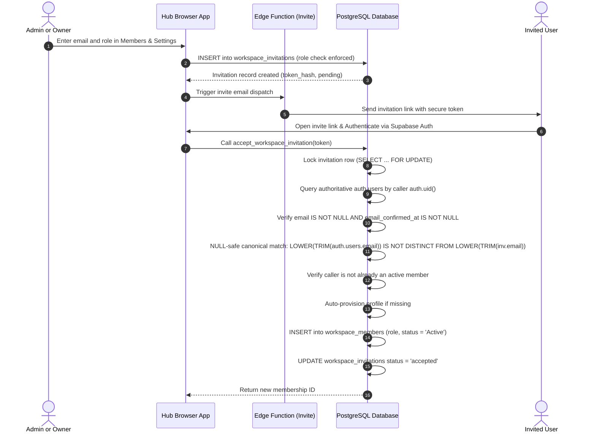

# Khai Space Hub — Row Level Security (RLS) & Multi-Tenant Security Design
**Document Version:** 1.3.0 (Phase 3.3 Security & Integrity Validation Finalized)  
**Phase:** Phase 3.3 Final SQL Validation & Security Closure  
**Application Target:** `apps/hub/`  
**Working Branch:** `feature/khai-space-hub`  
**Repository:** `khairultajudin/khaispace`

---

## 1. Security Philosophy & The Defense-in-Depth Model

Khai Space Hub adopts a strict **Zero-Trust Client** security architecture. Because the frontend is a statically compiled Single-Page Application communicating directly with Supabase PostgREST, client-side JavaScript checks cannot be relied upon as security boundaries.

### Core Security Rules
1. **Never Trust Client Workspace Headers:** A user must never be allowed to access or mutate records in a workspace simply by passing a `workspace_id` in the JSON payload or query parameters.
2. **PostgreSQL as Enforcer:** Row Level Security (RLS) evaluates every query against `auth.uid()`, verifying that the requesting user holds an active, non-suspended membership in the target workspace.
3. **Suspended Means Inactive:** Collaborators whose status is `'Suspended'` or `'Pending'` are blocked from reading or writing any workspace data.
4. **Viewer Role is Strictly Read-Only:** Users with the `'Viewer'` role can execute `SELECT` queries but are rejected on `INSERT`, `UPDATE`, and `DELETE`.
5. **No Service-Role Key in the Browser:** The Supabase Service Role Key is strictly banned from client code, environment variables, and build outputs.
6. **Strict Privilege Boundary Separation:** 
   - Administrators cannot manage another Administrator's record or status.
   - Administrators cannot promote any member to Administrator or Owner.
   - Administrators cannot modify or delete the Owner.
   - Administrators cannot modify their own membership role or status.
7. **Controlled Provisioning & Invitations:** Direct client `INSERT` on `workspaces` and `workspace_members` is disabled. Memberships are created exclusively via trusted functions (`create_workspace_with_owner` and `accept_workspace_invitation`).

---

## 2. Hardened Owner & Administrator Role Model

### 2.1 The Single-Owner Invariant: Exact Enforcement Mechanism
A workspace represents a private command center. The system guarantees that every active workspace has **exactly one Owner** ($\text{Count} = 1$).

To avoid inaccurate claims, this invariant is achieved through a multi-layered defense:
1. **Upper Bound ($\le 1$):** Enforced by the partial unique index:
   ```sql
   CREATE UNIQUE INDEX idx_workspace_single_owner 
     ON public.workspace_members (workspace_id) 
     WHERE (role = 'Owner');
   ```
2. **Lower Bound ($\ge 1$ at Provisioning):** Direct `INSERT` on `workspaces` is revoked. Workspaces can only be created via `public.create_workspace_with_owner()`, which atomically provisions the workspace, the initial `Owner` membership, and default settings in a single transaction.
3. **Lower Bound ($\ge 1$ during Operation):**
   - The trigger `protect_workspace_members_immutability()` prohibits updating an existing Owner's role away from `'Owner'`.
   - The trigger `protect_workspace_members_deletion()` prohibits deleting the Owner record during standard roster operations.
4. **Ownership Transfer Policy:** Ownership transfer is **explicitly prohibited** in this version. Any attempt to promote a member to Owner or mutate `user_id` on an Owner record is blocked by trigger exceptions.

### 2.2 Workspace Deletion Lifecycle & Owner Protection Coordination
- **Lifecycle Rule:** Only the verified `Owner` can delete a workspace.
- **Enforcement Architecture:**
  1. Direct client `DELETE` on `workspaces` is restricted by RLS to `Owner` role.
  2. The trigger `trg_workspace_deletion_auth` fires `BEFORE DELETE ON public.workspaces`:
     - Verifies caller is active `Owner` of `OLD.id`.
     - Sets a transaction-local session flag: `PERFORM set_config('app.deleting_workspace_id', OLD.id::text, true);`.
  3. PostgreSQL begins cascading deletions to child tables, including `workspace_members`.
  4. The trigger `protect_workspace_members_deletion()` checks:
     ```sql
     IF OLD.role = 'Owner' THEN
       IF current_setting('app.deleting_workspace_id', true) = OLD.workspace_id::text THEN
         RETURN OLD; -- Authorized workspace teardown
       END IF;
       RAISE EXCEPTION 'Security Policy Violation: The workspace Owner cannot be removed.';
     END IF;
     ```
  5. If an unauthorized caller or standard roster mutation attempts to delete the Owner, the session flag is unset, immediately triggering an exception.

### 2.3 Comprehensive Administrator & Owner Boundary Separation
To enforce strict role tiers:
1. **Immutable Identifiers:** Trigger `protect_workspace_members_immutability()` strictly blocks any update to `user_id` or `workspace_id` across all roster records.
2. **Owner Role Management:**
   - Can update and remove `Administrator`, `Member`, and `Viewer` records.
   - Cannot demote or delete their own protected `Owner` membership.
   - Cannot create another `Owner`.
3. **Administrator Role Management:**
   - Can manage `Member` and `Viewer` records ONLY.
   - Cannot modify another Administrator's record or status.
   - Cannot promote a Member or Viewer to Administrator.
   - Cannot modify or remove the Owner.
   - Cannot alter their own membership record or self-promote.
4. **Trigger-Level Boundary Enforcement:**
   In `protect_workspace_members_immutability()`:
   ```sql
   caller_role := public.get_user_workspace_role(OLD.workspace_id);
   IF caller_role = 'Administrator' THEN
     IF OLD.role = 'Administrator' THEN
       RAISE EXCEPTION 'Security Policy Violation: Administrators cannot modify another Administrator.';
     END IF;
     IF NEW.role = 'Administrator' AND OLD.role != 'Administrator' THEN
       RAISE EXCEPTION 'Security Policy Violation: Administrators cannot promote members to Administrator.';
     END IF;
   END IF;
   ```

---

## 3. The Recursive RLS Policy Trap & Architectural Solution

### 3.1 The Problem: Infinite Policy Recursion
In a multi-tenant PostgreSQL RLS design, evaluating membership within `workspace_members` using a subquery on `workspace_members` results in recursive evaluation and engine failure.

### 3.2 The Solution: Fast `SECURITY DEFINER` Helper Functions
Three PostgreSQL helper functions are defined with `SECURITY DEFINER`, `STABLE` caching, and a fixed, secure `search_path`:

```sql
-- Helper 1: Check active non-suspended membership
CREATE OR REPLACE FUNCTION public.is_workspace_member(ws_id uuid)
RETURNS boolean
LANGUAGE sql
STABLE
SECURITY DEFINER
SET search_path = public, auth, pg_temp
AS $$
  SELECT EXISTS (
    SELECT 1 
    FROM public.workspace_members 
    WHERE workspace_id = ws_id 
      AND user_id = auth.uid() 
      AND status = 'Active'
  );
$$;

-- Helper 2: Retrieve user's role in a workspace
CREATE OR REPLACE FUNCTION public.get_user_workspace_role(ws_id uuid)
RETURNS public.member_role
LANGUAGE sql
STABLE
SECURITY DEFINER
SET search_path = public, auth, pg_temp
AS $$
  SELECT role 
  FROM public.workspace_members 
  WHERE workspace_id = ws_id 
    AND user_id = auth.uid() 
    AND status = 'Active';
$$;

-- Helper 3: Check if user is Workspace Admin or Owner
CREATE OR REPLACE FUNCTION public.is_workspace_admin_or_owner(ws_id uuid)
RETURNS boolean
LANGUAGE sql
STABLE
SECURITY DEFINER
SET search_path = public, auth, pg_temp
AS $$
  SELECT EXISTS (
    SELECT 1 
    FROM public.workspace_members 
    WHERE workspace_id = ws_id 
      AND user_id = auth.uid() 
      AND role IN ('Owner', 'Administrator')
      AND status = 'Active'
  );
$$;

-- Revoke anonymous access; grant to authenticated only
REVOKE EXECUTE ON FUNCTION public.is_workspace_member(uuid) FROM public, anon;
GRANT EXECUTE ON FUNCTION public.is_workspace_member(uuid) TO authenticated;

REVOKE EXECUTE ON FUNCTION public.get_user_workspace_role(uuid) FROM public, anon;
GRANT EXECUTE ON FUNCTION public.get_user_workspace_role(uuid) TO authenticated;

REVOKE EXECUTE ON FUNCTION public.is_workspace_admin_or_owner(uuid) FROM public, anon;
GRANT EXECUTE ON FUNCTION public.is_workspace_admin_or_owner(uuid) TO authenticated;
```

---

## 4. Secure Member Onboarding & Invitation Lifecycle

Direct client `INSERT` on `workspace_members` is completely disabled. Members cannot be unilaterally injected by arbitrary client requests.



### Key Security Invariants in Invitation Flow:
1. **Role-Restricted Invitations:**
   - Table constraint `chk_invitation_role CHECK (role != 'Owner')` permanently blocks Owner invitations.
   - RLS policy enforces that only the `Owner` can invite `Administrator` roles; Administrators can only invite `Member` and `Viewer` roles.
2. **Cryptographic Token Verification:** Tokens are stored as SHA-256 hashes (`token_hash = encode(digest(TRIM(p_token), 'sha256'), 'hex')`). Plaintext tokens never persist in the database.
3. **Verified Email Identity Enforcement:**
   - The authenticated caller is identified exclusively via `auth.uid()`.
   - The authoritative user record is fetched directly from `auth.users`.
   - Caller ID, record existence, email existence, and non-empty email are strictly validated.
   - Caller email confirmation is mandatory (`email_confirmed_at IS NOT NULL`). Unconfirmed accounts are rejected.
   - Raw user metadata (`raw_user_meta_data`) and unverified JWT claims are never trusted for email identity.
   - Canonical lowercase trimmed email values are compared using `IS DISTINCT FROM`.
4. **Concurrency Protection:** The invitation record is retrieved with `SELECT ... FOR UPDATE`, serializing concurrent redemption attempts.
5. **Clean Already-Member Rejection:** If the caller is already a member, the function immediately raises a deterministic exception without modifying the invitation status or leaving partial side-effects.

---

## 5. Audit Logging Foreign Key & Trust Model

### 5.1 Relational Retention Model
- Column definition:
  ```sql
  user_id uuid REFERENCES public.profiles(id) ON DELETE SET NULL,
  actor_email varchar(255),
  actor_role varchar(20),
  ```
- **Behavior:**
  - If a user profile is deleted, `user_id` is cleanly nullified without violating constraints.
  - Immutable snapshots (`actor_email`, `actor_role`) are captured at creation time, preserving non-repudiation for historical records.

### 5.2 Anti-Forgery & Trust Boundaries
- **Direct Client INSERT Disabled:** Ordinary browser clients cannot execute `INSERT INTO activity_logs`.
- **System Event Logging:** Sensitive events are recorded directly by PostgreSQL database triggers.
- **Client Event Logging:** Permitted UI events are recorded via `public.log_workspace_activity(...)`:
  - Enforces `is_workspace_member(p_workspace_id)`.
  - Captures `auth.uid()`, lookup profile email and member role.
  - Prohibits non-administrators from submitting privileged action types (`admin.*`).
- **Realistic Trust Boundary:** This design provides robust protection against ordinary authenticated users and malicious browser scripts, but does not claim cryptographic WORM (Write Once Read Many) immutability against database superusers.

---

## 6. Table-by-Table RLS Policy Matrix

| Table | SELECT | INSERT | UPDATE | DELETE |
| :--- | :--- | :--- | :--- | :--- |
| `workspaces` | Active Member | **Disabled** (via `create_workspace_with_owner`) | Admin or Owner | Owner Only (via `trg_workspace_deletion_auth`) |
| `profiles` | Self OR Shared Workspace Member | Self (`id = auth.uid()`) | Self (`id = auth.uid()`) | **Disabled** (Managed via Auth cleanup) |
| `workspace_members` | Active Member | **Disabled** (via atomic provisioning / invite acceptance) | Owner: Admin/Member/Viewer<br>Admin: Member/Viewer only | Owner: Admin/Member/Viewer<br>Admin: Member/Viewer only |
| `workspace_invitations` | Admin or Owner | Owner: Admin/Member/Viewer<br>Admin: Member/Viewer only | Owner: Any<br>Admin: Member/Viewer only | Owner: Any<br>Admin: Member/Viewer only |
| `workspace_settings` | Active Member | **Disabled** (Initialized at workspace creation) | Admin or Owner | **Disabled** (Cascade only) |
| `projects` | Active Member | Active Non-Viewer | Active Non-Viewer | Admin or Owner |
| `milestones` | Active Member | Active Non-Viewer | Active Non-Viewer | Active Non-Viewer |
| `tasks` | Active Member | Active Non-Viewer | Active Non-Viewer | Active Non-Viewer |
| `financial_transactions` | Active Member | Active Non-Viewer | Active Non-Viewer | Admin or Owner |
| `ai_subscriptions` | Active Member | Active Non-Viewer | Active Non-Viewer | Admin or Owner |
| `workspace_notes` | Active Member | Active Non-Viewer | Active Non-Viewer | Active Non-Viewer |
| `activity_logs` | Active Member | **Disabled** (via triggers / `log_workspace_activity`) | **Disabled** (Permanent) | **Disabled** (Permanent) |

---

## 7. Complete Function Security & Privilege Inventory

The schema defines **17 functions in total**, comprising **15 `SECURITY DEFINER` functions** and **2 `SECURITY INVOKER` functions**. Every `SECURITY DEFINER` function explicitly locks down search path resolution via `SET search_path = public, auth, pg_temp` to prevent search_path injection attacks.

### 7.1 Category A: Database Trigger Functions (8 Functions)
Trigger functions execute solely in response to database lifecycle events. All external RPC execution privileges are explicitly revoked from `PUBLIC`, `anon`, and `authenticated`.

| Function Name | Attached Trigger / Table | Execution Boundary | Permissions |
| :--- | :--- | :--- | :--- |
| `public.validate_project_workspace_integrity()` | `trg_tasks_project_workspace_check` on `tasks` | Trigger only | `REVOKE ALL FROM public, anon, authenticated` |
| `public.validate_subscription_project_workspace_integrity()` | `trg_ai_subscriptions_project_workspace_check` on `ai_subscriptions` | Trigger only | `REVOKE ALL FROM public, anon, authenticated` |
| `public.handle_project_deletion_cleanup()` | `trg_projects_deletion_cleanup` on `projects` | Trigger only | `REVOKE ALL FROM public, anon, authenticated` |
| `public.handle_milestone_deletion_cleanup()` | `trg_milestones_deletion_cleanup` on `milestones` | Trigger only | `REVOKE ALL FROM public, anon, authenticated` |
| `public.handle_new_user()` | `on_auth_user_created` on `auth.users` | Supabase Auth trigger only | `REVOKE ALL FROM public, anon, authenticated` |
| `public.handle_workspace_deletion_authorization()` | `trg_workspace_deletion_auth` on `workspaces` | Trigger only | `REVOKE ALL FROM public, anon, authenticated` |
| `public.protect_workspace_members_immutability()` | `trg_protect_members_immutability` on `workspace_members` | Trigger only | `REVOKE ALL FROM public, anon, authenticated` |
| `public.protect_workspace_members_deletion()` | `trg_protect_members_deletion` on `workspace_members` | Trigger only | `REVOKE ALL FROM public, anon, authenticated` |

### 7.2 Category B: Anti-Recursion RLS Engine Helpers (3 Functions)
Helper functions evaluate caller permissions inside RLS policies without causing recursive policy evaluation loops. They are declared `STABLE` to allow PostgreSQL to cache results within single query plans.

| Function Name | Purpose | Execution Boundary | Permissions |
| :--- | :--- | :--- | :--- |
| `public.is_workspace_member(uuid)` | Verifies caller has an `Active` membership in target workspace | RLS Policy Evaluation / Authenticated | `REVOKE FROM public, anon; GRANT TO authenticated` |
| `public.get_user_workspace_role(uuid)` | Returns caller's active role (`Owner`, `Administrator`, `Member`, `Viewer`) | RLS Policy Evaluation / Authenticated | `REVOKE FROM public, anon; GRANT TO authenticated` |
| `public.is_workspace_admin_or_owner(uuid)` | Verifies caller holds `Owner` or `Administrator` role | RLS Policy Evaluation / Authenticated | `REVOKE FROM public, anon; GRANT TO authenticated` |

### 7.3 Category C: User-Facing RPC Functions & Stored Procedures (4 Functions)
These functions provide transactional business logic that bypasses direct client table mutations while enforcing strict validation and authorization.

| Function Name | Purpose | Caller Trust Boundary | Permissions |
| :--- | :--- | :--- | :--- |
| `public.create_workspace_with_owner(varchar, text, varchar)` | Creates workspace, auto-provisions profile, and assigns caller as `Owner` atomically | Authenticated users | `REVOKE FROM public, anon; GRANT TO authenticated` |
| `public.accept_workspace_invitation(text)` | Validates verified email (`auth.users.email_confirmed_at IS NOT NULL`), acquires row lock, and creates membership | Authenticated users with confirmed email matching invite | `REVOKE FROM public, anon; GRANT TO authenticated` |
| `public.delete_workspace_by_owner(uuid)` | Authorizes workspace deletion strictly by certified workspace `Owner` | Authenticated `Owner` | `REVOKE FROM public, anon; GRANT TO authenticated` |
| `public.log_workspace_activity(...)` | Validates caller membership and records client UI activity in `activity_logs` | Authenticated members | `REVOKE FROM public, anon; GRANT TO authenticated` |

### 7.4 Category D: Non-Security Definer Functions (2 Functions)
These functions do not access external tables or require elevated privileges. They execute with standard `SECURITY INVOKER` semantics.

| Function Name | Purpose | Execution Boundary |
| :--- | :--- | :--- |
| `public.handle_updated_at()` | Sets `NEW.updated_at = now()` before updates | Trigger only (`BEFORE UPDATE`) |
| `public.prevent_note_type_change()` | Enforces note type immutability between `'Note'` and `'Decision'` | Trigger only (`BEFORE UPDATE`) |

