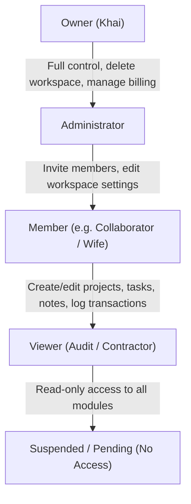

# Khai Space Hub — Row Level Security (RLS) & Multi-Tenant Security Design
**Document Version:** 1.0.0  
**Phase:** Phase 3 Architecture & Persistence Planning  
**Application Target:** `apps/hub/`  
**Working Branch:** `feature/khai-space-hub`  
**Repository:** `khairultajudin/khaispace`

---

## 1. Security Philosophy & The Defense-in-Depth Model

Khai Space Hub adopts a strict **Zero-Trust Client** security architecture. Because the frontend is a statically compiled Single-Page Application communicating directly with Supabase PostgREST, client-side JavaScript checks cannot be relied upon as security boundaries.

### Core Security Rules
1. **Never Trust Client Workspace Headers:** A user must never be allowed to access or mutate records in a workspace simply by passing a `workspace_id` in the JSON payload or query parameters.
2. **PostgreSQL as Enforcer:** Row Level Security (RLS) evaluates every query against `auth.uid()`, verifying that the requesting user holds an active, non-suspended membership in the target workspace.
3. **Suspended Means Inactive:** Collaborators whose status is `'Suspended'` or `'Pending'` are blocked from reading or writing any workspace data.
4. **Viewer Role is Strictly Read-Only:** Users with the `'Viewer'` role can execute `SELECT` queries but are rejected on `INSERT`, `UPDATE`, and `DELETE`.
5. **No Service-Role Key in the Browser:** The Supabase Service Role Key is strictly banned from client code, environment variables, and build outputs.

---

## 2. The Recursive RLS Policy Trap & Architectural Solution

### 2.1 The Problem: Infinite Policy Recursion
In a naive multi-tenant PostgreSQL RLS design, protecting `workspace_members` with a policy like this:
```sql
-- DANGEROUS: Causes Infinite Recursion
CREATE POLICY member_access ON workspace_members
  FOR SELECT USING (
    workspace_id IN (
      SELECT workspace_id FROM workspace_members WHERE user_id = auth.uid()
    )
  );
```
causes PostgreSQL to re-evaluate the policy while executing the subquery on `workspace_members`, leading to infinite recursion (`error: infinite recursion detected in policy for relation "workspace_members"`).

### 2.2 The Solution: Fast `SECURITY DEFINER` Helper Functions
To eliminate recursion and optimize policy evaluation performance, we implement two PostgreSQL helper functions defined with `SECURITY DEFINER` and a fixed, secure `search_path`:

```sql
-- Helper 1: Check active non-suspended membership
CREATE OR REPLACE FUNCTION public.is_workspace_member(ws_id uuid)
RETURNS boolean
LANGUAGE sql
STABLE
SECURITY DEFINER
SET search_path = public, auth
AS $$
  SELECT EXISTS (
    SELECT 1 
    FROM public.workspace_members 
    WHERE workspace_id = ws_id 
      AND user_id = auth.uid() 
      AND status = 'Active'
  );
$$;

-- Helper 2: Retrieve user's role in a workspace
CREATE OR REPLACE FUNCTION public.get_user_workspace_role(ws_id uuid)
RETURNS public.member_role
LANGUAGE sql
STABLE
SECURITY DEFINER
SET search_path = public, auth
AS $$
  SELECT role 
  FROM public.workspace_members 
  WHERE workspace_id = ws_id 
    AND user_id = auth.uid() 
    AND status = 'Active';
$$;

-- Helper 3: Check if user is Workspace Admin or Owner
CREATE OR REPLACE FUNCTION public.is_workspace_admin_or_owner(ws_id uuid)
RETURNS boolean
LANGUAGE sql
STABLE
SECURITY DEFINER
SET search_path = public, auth
AS $$
  SELECT EXISTS (
    SELECT 1 
    FROM public.workspace_members 
    WHERE workspace_id = ws_id 
      AND user_id = auth.uid() 
      AND role IN ('Owner', 'Administrator')
      AND status = 'Active'
  );
$$;
```

**Security Analysis of Helpers:**
- `STABLE` keyword allows PostgreSQL to cache the result for the duration of a single transaction, dramatically improving query throughput.
- `SET search_path = public, auth` prevents search-path hijacking attacks where a malicious user creates a duplicate table in their own schema.
- Functions execute with owner permissions only inside their isolated body, breaking the recursive loop on `workspace_members`.

---

## 3. Role-Based Access Control (RBAC) Hierarchy

The Hub defines four distinct collaborative roles:



| Role | Permissions Summary |
|:---|:---|
| **Owner** | Full workspace authority. Can edit workspace configuration, invite/remove members, assign roles, view/edit/delete all entities, and manage billing. Cannot be deleted or demoted. |
| **Administrator** | Can invite members, edit workspace settings, and manage all operational entities (projects, tasks, finances, subscriptions, notes). Cannot delete the Owner or transfer ownership. |
| **Member** | Standard collaborator. Can create, edit, and manage projects, tasks, milestones, transactions, subscriptions, and notes. Cannot invite members or alter workspace settings. |
| **Viewer** | Read-only auditor. Can view dashboards, rosters, project catalogs, and financial summaries, but cannot insert, update, or delete any record. |
| **Suspended** | Revoked collaborator. Access is blocked at the database boundary for all operations. |

---

## 4. Comprehensive RLS Policy Matrix for All Tables

RLS is enabled explicitly on every table: `ALTER TABLE <table_name> ENABLE ROW LEVEL SECURITY;`.

| Table | Operation | Target Role | Policy Rule (`USING` / `WITH CHECK`) |
|:---|:---:|:---:|:---|
| **`profiles`** | SELECT | Authenticated | Can view own profile, or profiles of users sharing an active workspace |
| | UPDATE | Owner of Profile | `id = auth.uid()` |
| | INSERT | Authenticated | `id = auth.uid()` |
| | DELETE | None | Prohibited (Managed via Supabase Auth) |
| **`workspaces`** | SELECT | Active Member | `public.is_workspace_member(id)` |
| | UPDATE | Admin / Owner | `public.is_workspace_admin_or_owner(id)` |
| | INSERT | Authenticated | Can create new workspace (initial setup) |
| | DELETE | Owner Only | `public.get_user_workspace_role(id) = 'Owner'` |
| **`workspace_members`** | SELECT | Active Member | `public.is_workspace_member(workspace_id)` |
| | INSERT | Admin / Owner | `public.is_workspace_admin_or_owner(workspace_id)` |
| | UPDATE | Admin / Owner | `public.is_workspace_admin_or_owner(workspace_id)` (Protected by trigger from demoting Owner) |
| | DELETE | Admin / Owner | `public.is_workspace_admin_or_owner(workspace_id)` (Protected by trigger from removing Owner) |
| **`workspace_invitations`**| SELECT | Admin / Owner | `public.is_workspace_admin_or_owner(workspace_id)` |
| | INSERT | Admin / Owner | `public.is_workspace_admin_or_owner(workspace_id)` |
| | UPDATE | Admin / Owner | `public.is_workspace_admin_or_owner(workspace_id)` |
| | DELETE | Admin / Owner | `public.is_workspace_admin_or_owner(workspace_id)` |
| **`workspace_settings`** | SELECT | Active Member | `public.is_workspace_member(workspace_id)` |
| | UPDATE | Admin / Owner | `public.is_workspace_admin_or_owner(workspace_id)` |
| | INSERT / DELETE | None | Managed via workspace creation cascade |
| **`projects`** | SELECT | Active Member | `public.is_workspace_member(workspace_id)` |
| | INSERT | Member + | `public.is_workspace_member(workspace_id) AND public.get_user_workspace_role(workspace_id) != 'Viewer'` |
| | UPDATE | Member + | `public.is_workspace_member(workspace_id) AND public.get_user_workspace_role(workspace_id) != 'Viewer'` |
| | DELETE | Admin / Owner | `public.is_workspace_admin_or_owner(workspace_id)` |
| **`milestones`** | SELECT | Active Member | `public.is_workspace_member(workspace_id)` |
| | INSERT / UPDATE | Member + | `public.is_workspace_member(workspace_id) AND public.get_user_workspace_role(workspace_id) != 'Viewer'` |
| | DELETE | Member + | `public.is_workspace_member(workspace_id) AND public.get_user_workspace_role(workspace_id) != 'Viewer'` |
| **`tasks`** | SELECT | Active Member | `public.is_workspace_member(workspace_id)` |
| | INSERT / UPDATE | Member + | `public.is_workspace_member(workspace_id) AND public.get_user_workspace_role(workspace_id) != 'Viewer'` |
| | DELETE | Member + | `public.is_workspace_member(workspace_id) AND public.get_user_workspace_role(workspace_id) != 'Viewer'` |
| **`financial_transactions`**| SELECT | Active Member | `public.is_workspace_member(workspace_id)` |
| | INSERT | Member + | `public.is_workspace_member(workspace_id) AND public.get_user_workspace_role(workspace_id) != 'Viewer'` |
| | UPDATE | Member + | `public.is_workspace_member(workspace_id) AND public.get_user_workspace_role(workspace_id) != 'Viewer'` |
| | DELETE | Admin / Owner | `public.is_workspace_admin_or_owner(workspace_id)` (Deletions restricted to preserve ledger integrity) |
| **`ai_subscriptions`** | SELECT | Active Member | `public.is_workspace_member(workspace_id)` |
| | INSERT / UPDATE | Member + | `public.is_workspace_member(workspace_id) AND public.get_user_workspace_role(workspace_id) != 'Viewer'` |
| | DELETE | Admin / Owner | `public.is_workspace_admin_or_owner(workspace_id)` |
| **`workspace_notes`** | SELECT | Active Member | `public.is_workspace_member(workspace_id)` |
| | INSERT / UPDATE | Member + | `public.is_workspace_member(workspace_id) AND public.get_user_workspace_role(workspace_id) != 'Viewer'` |
| | DELETE | Member + | `public.is_workspace_member(workspace_id) AND public.get_user_workspace_role(workspace_id) != 'Viewer'` |
| **`activity_logs`** | SELECT | Active Member | `public.is_workspace_member(workspace_id)` |
| | INSERT | Active Member | `public.is_workspace_member(workspace_id)` |
| | UPDATE / DELETE | None | **Permanently Prohibited (Immutable Audit Log)** |

---

## 5. Owner Immutability Protection Trigger

To prevent accidental lockout or demotion of the workspace owner, a PostgreSQL trigger enforces ownership protection:

```sql
CREATE OR REPLACE FUNCTION public.protect_workspace_owner()
RETURNS TRIGGER
LANGUAGE plpgsql
AS $$
BEGIN
  -- Prevent deletion of Owner
  IF TG_OP = 'DELETE' AND OLD.role = 'Owner' THEN
    RAISE EXCEPTION 'Security Violation: The workspace Owner cannot be removed.';
  END IF;

  -- Prevent demotion or suspension of Owner
  IF TG_OP = 'UPDATE' AND OLD.role = 'Owner' THEN
    IF NEW.role != 'Owner' THEN
      RAISE EXCEPTION 'Security Violation: The workspace Owner cannot be demoted.';
    END IF;
    IF NEW.status != 'Active' THEN
      RAISE EXCEPTION 'Security Violation: The workspace Owner cannot be suspended.';
    END IF;
  END IF;

  RETURN NEW;
END;
$$;

CREATE TRIGGER trg_protect_workspace_owner
  BEFORE UPDATE OR DELETE ON public.workspace_members
  FOR EACH ROW
  EXECUTE FUNCTION public.protect_workspace_owner();
```

---

## 6. Threat Modeling & Attack Surface Mitigation

| Threat Vector | Potential Impact | Architecture Mitigation Strategy |
|:---|:---|:---|
| **Insecure Direct Object Reference (IDOR)** | Attacker guesses task UUID or transaction UUID from another workspace | Every query evaluates `workspace_id = ws_id AND public.is_workspace_member(workspace_id)`. Guessing a UUID returns HTTP 404 / empty set. |
| **Cross-Tenant Data Leakage** | Compromised user account leaks data to another tenant | All tables are partitioned logically by `workspace_id` in RLS policies. No query can bypass RLS without service-role key. |
| **Privilege Escalation** | Member updates own role to `Administrator` or `Owner` | RLS policy on `workspace_members` restricts `UPDATE` to existing Admins/Owners; database trigger prohibits demoting/replacing Owner. |
| **Financial Ledger Tampering** | Malicious collaborator deletes investment records to alter ROI | Only `Administrator` or `Owner` can delete transactions; audit log records every deletion with previous row values in JSONB. |
| **Direct API PostgREST Bypass** | Attacker bypasses frontend form validation and submits negative amount or invalid enum | Database `CHECK (amount > 0)`, typed PostgreSQL enums, and foreign keys reject invalid payloads with database constraint errors. |
| **Public Signup Attack** | Public visitor triggers `auth.signUp` to gain workspace access | Supabase Auth configured with **Public Signup Disabled**. Users can only register when accepted via an explicit invitation record in `workspace_invitations`. |
