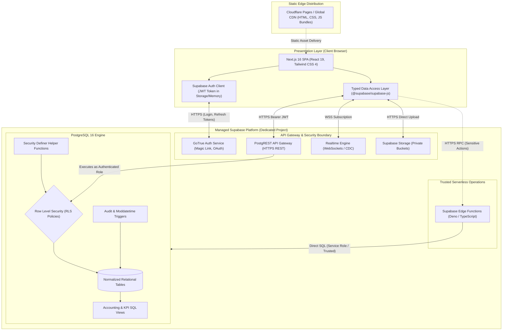

# Khai Space Hub — Target System Architecture & Static Export Compatibility
**Document Version:** 1.0.0  
**Phase:** Phase 3 Architecture & Persistence Planning  
**Application Target:** `apps/hub/`  
**Working Branch:** `feature/khai-space-hub`  
**Repository:** `khairultajudin/khaispace`

---

## 1. Architectural Vision & Core Principles

Khai Space Hub is designed as a **private, resilient, and high-performance engineering command center**. The system architecture balances operational simplicity, maximum security, strict workspace isolation, and zero server maintenance overhead.

### Core Architectural Principles
1. **Zero Secret Exposure on Client:** Service-role keys and master database credentials must never enter the browser environment.
2. **Database as Single Source of Truth:** All business validations, authorization rules, and monetary accuracy are enforced inside PostgreSQL via Row Level Security (RLS), constraints, and typed triggers.
3. **Static Export Preservation:** The Next.js frontend maintains its static export configuration (`output: "export"`), enabling sub-second delivery from Cloudflare Pages without running a stateful Node.js server.
4. **Isolated Project Boundary:** The Hub operates within its own dedicated Supabase project, strictly isolated from other applications (e.g. BizTrack).
5. **Private Workspace Model:** Public self-registration is permanently disabled. Access is granted strictly by invitation from the workspace Owner.

---

## 2. High-Level System Architecture Diagram



---

## 3. Static Export Compatibility Analysis & Architectural Options

`apps/hub/next.config.ts` declares `output: "export"`. Under this configuration, Next.js compiles exclusively into static static assets. This has major architectural implications for authentication, routing, and database access.

### 3.1 Comparison of Architectural Approaches

| Architectural Dimension | Option 1: Direct Browser-to-Supabase with RLS | Option 2: Full Next.js SSR / Server Actions | Option 3: Hybrid (Static Export + Supabase Edge Functions) |
|:---|:---|:---|:---|
| **Next.js Build Output** | `output: "export"` (Static) | Node / Edge Server Runtime (Dynamic) | `output: "export"` (Static) |
| **Hosting Infrastructure** | Cloudflare Pages (Free / Zero Config) | Cloudflare Workers or VPS Server | Cloudflare Pages + Supabase Managed Functions |
| **SSR Cold Starts** | **None** (Instant CDN delivery) | Yes (Edge worker cold start / latency) | **None** (Instant CDN delivery) |
| **Database Connection Model** | PostgREST HTTP REST over HTTPS | Direct connection pooling (`pg` / Prisma) | PostgREST HTTP + Deno connection |
| **Authorization Boundary** | PostgreSQL RLS on every query | Next.js middleware + database logic | PostgreSQL RLS + Edge Function guards |
| **Handling of Sensitive Tasks** | Impossible without server boundary | Handled in Server Actions | Handled in Supabase Edge Functions |
| **Operational Overhead** | Extremely Low | Medium (Server monitoring, secrets) | **Low (Managed, serverless)** |
| **Compatibility with Current Repo** | **100% Drop-In Compatible** | Requires rewriting `next.config.ts` | **100% Drop-In Compatible** |

### 3.2 Evaluation of Limitations & Recommended Architecture

#### The Limitations of Option 1 (Pure Browser-to-Supabase)
While pure browser-to-Supabase handles 95% of standard CRUD operations cleanly via PostgREST and RLS, it has three critical limitations:
1. **Inviting New Collaborators:** Sending an invitation email with a secure token using Supabase Admin API (`auth.admin.inviteUserByEmail`) requires the Supabase Service Role Key. Exposing this key in browser code would compromise the entire database.
2. **Elevated Auditing & Deletion:** Triggering irreversible multi-table workspace deletions or financial lock operations should be guarded by server-side verification rather than client commands.
3. **External Webhook Integrations:** Syncing AI subscription billing alerts or Stripe/bank notifications requires an endpoint that can receive incoming HTTP webhooks.

#### The Drawbacks of Option 2 (Full Next.js Dynamic SSR)
Switching the Next.js application from static export to dynamic SSR would break the repository's unified deployment model, mandate configuring Cloudflare Workers runtime (`@cloudflare/next-on-pages`), increase operational maintenance, and introduce cold-start latency.

#### Recommended Choice: Option 3 (The Hybrid Architecture)
We recommend the **Hybrid Architecture**:
- **Preserve Next.js Static Export:** `apps/hub` remains an `output: "export"` Single-Page Application deployed to Cloudflare Pages.
- **Direct Browser PostgREST Access for Standard CRUD:** All read, insert, update, and delete operations on projects, tasks, milestones, transactions, subscriptions, and notes execute directly from the browser to Supabase PostgREST, authenticated by the user's JWT and guarded by strict Row Level Security.
- **Supabase Edge Functions for Elevated Administrative Tasks:**
  - `invite-member`: Validates inviter's Admin/Owner status, generates invite token, and uses `auth.admin` on Supabase's trusted Deno runtime.
  - `backup-export`: Generates an encrypted JSON dump of the user's workspace.
  - `financial-audit`: Runs integrity checks on historical transactions.

---

## 4. Responsibilities of Each System Layer

### 4.1 Presentation Layer (Next.js 16 Client)
- **Role:** Renders the user interface, manages responsive layout, provides optimistic UI feedback, and handles client-side form validation.
- **Technology:** React 19, Tailwind CSS 4, Lucide React icons.
- **Authentication State:** Manages current session tokens via `@supabase/supabase-js`, handling silent token refresh and session expiry redirection.

### 4.2 Data Access Layer (`apps/hub/src/services/`)
- **Role:** Encapsulates PostgREST queries into strongly-typed, reusable service modules.
- **Structure:**
  - `projects-service.ts`
  - `tasks-service.ts`
  - `finance-service.ts`
  - `subscriptions-service.ts`
  - `notes-service.ts`
  - `members-service.ts`
  - `settings-service.ts`
- **Error Handling:** Translates PostgREST HTTP error codes (e.g. `PGRST116`, `42501 Permission Denied`) into user-friendly error notifications.

### 4.3 Security & API Gateway (Supabase PostgREST & GoTrue)
- **Role:** Validates incoming Bearer JWT tokens, translates HTTP REST queries into parameterized SQL statements, and enforces PostgreSQL execution contexts.
- **GoTrue:** Handles magic link delivery, token minting, and refresh token rotation.
- **Realtime:** Listens to PostgreSQL Write-Ahead Logs (WAL) and publishes filtered change-data-capture events over WebSockets to authorized clients.

### 4.4 Database Layer (PostgreSQL 16)
- **Role:** Absolute authority on relational integrity, data consistency, multi-tenant isolation, and business rules.
- **Row Level Security (RLS):** Every query is evaluated under the identity of `auth.uid()`, preventing cross-workspace leakage.
- **Computed SQL Views:** Complex financial rollups and monthly trend aggregations are computed directly by the database engine for maximum speed and accuracy.

---

## 5. Client-Side Caching, Data Validation, and Optimistic Updates

1. **Schema Typing:** Auto-generate TypeScript types using the Supabase CLI (`supabase gen types typescript`) into `apps/hub/src/types/database.types.ts`.
2. **Form Validation:** All user inputs are validated client-side before transmission using strict type guards and regex matchers (e.g. ISO calendar date check, positive monetary amounts).
3. **Optimistic UI Updates:** For low-latency interactions (e.g. toggling a task between Pending and Completed), the UI state updates immediately while dispatching the background update to Supabase. If the server rejects the mutation (e.g. network failure or RLS rejection), the UI rolls back to previous state and displays a warning toast.
4. **Cache Invalidation:** Because the application is a private workspace with low write concurrency, caching will be managed via lightweight React state with stale-while-revalidate semantics on section navigation.

---

## 6. Realtime Multi-User Synchronization

When Khai's wife or an authorized team collaborator updates a task, adds a note, or logs a transaction, the change should reflect in real-time without requiring a hard browser refresh:
- The data access layer subscribes to PostgreSQL CDC channels filtered by `workspace_id`:
  ```typescript
  supabase
    .channel(`workspace:${workspaceId}`)
    .on('postgres_changes', { event: '*', schema: 'public', filter: `workspace_id=eq.${workspaceId}` }, handleSync)
    .subscribe();
  ```
- This guarantees instant synchronization between desktop and mobile devices.
