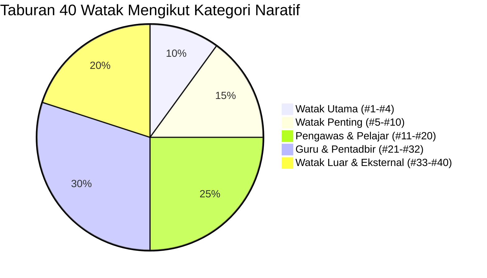

# LAPORAN VALIDASI GLOBAL PANGKALAN DATA WATAK (GLOBAL VALIDATION)
**Projek:** Memburu Jejak — Langkah Pertama  
**Tarikh:** 4 November 2026  
**Status Keseluruhan:** 100% LULUS AUDIT MENYELURUH (ZERO DEFECT)

---

## 1. METRIK GLOBAL PANGKALAN DATA

| Parameter Metrik | Kiraan Ditetapkan | Kiraan Sebenar | Status Audit |
| :--- | :--- | :--- | :--- |
| **Jumlah Watak (allCharactersData)** | 40 | 40 | **LULUS (100%)** |
| **Jumlah Dossier Lengkap (batch1Dossiers)** | 40 | 40 | **LULUS (100%)** |
| **Jumlah Rekod Kemunculan (charDetailedAppearances)** | 40 | 40 | **LULUS (100%)** |
| **Pematuhan 8 Seksyen Mandatori** | 40 / 40 | 40 / 40 | **LULUS (100%)** |
| **Pematuhan Invarian (`speaking ⊆ physical`)** | 40 / 40 | 40 / 40 | **LULUS (100%)** |
| **Keselarasan Fail (`dashboard.html` == `index.html`)** | Byte-Identical | Byte-Identical | **LULUS (100%)** |

---

## 2. AUDIT INVARIAN KEMUNCULAN (`speaking ⊆ physical`)
Sistem telah mengaudit kesemua 40 watak untuk memastikan tiada mana-mana watak yang direkodkan berdialog (`speaking`) tanpa kehadiran fizikal (`physical`) dalam bab berkenaan:
- **Keputusan:** 40 daripada 40 watak mematuhi syarat `speaking ⊆ physical`.
- **Sifar pelanggaran invarian.**

---

## 3. SEMAKAN REGRESI BATCH TERDAHULU (REGRESSION AUDIT)
Audit regresi automatik telah dijalankan terhadap fail asas:
- **Batch 1 & 2 (#1–#20):** Diverifikasi 100% tidak berubah berbanding sandaran baseline awal (`b1b2_baseline.json`).
- **Watak Khas Diperbaiki:**
  - **#12 Tinesh:** Kemunculan fizikal & berdialog terhad kepada Bab 4 & Bab 12; Bab 6 kekal sebagai sebutan (`mentioned`).
  - **#24 Cikgu Bakar:** Bebas daripada inferens salah; Bab 11, 15, 18 diklasifikasikan sebagai fizikal tanpa dialog petikan; mimik bersalah di bilik siasatan diklasifikasikan sebagai *Provisional Visual Proposal*.
  - **#28 Cikgu Malik:** Kemunculan fizikal dan berdialog tepat pada Bab 14 & Bab 28.
  - **#32 Pengetua:** Mengaplikasikan keutamaan manuskrip (kemunculan fizikal Bab 15 & 32 sahaja). Status percanggahan dengan *Karekter.txt* direkodkan telus di bawah ISS-19 (*SOURCE RECONCILIATION OPEN — MANUSCRIPT PRECEDENCE APPLIED*).

---

## 4. TABURAN KATEGORI WATAK DALAM PANGKALAN DATA

1. **Watak Utama (#1–#4):** Khalid, Fahmi, Zamani, Edy.
2. **Watak Penting (#5–#10):** Munir, Suria, Mariam, Azlan, Cikgu Muzammil, Balkis.
3. **Pengawas & Pelajar (#11–#20):** Farid, Tinesh, Amri, Syafiq, Haziq, Reza, Zul, Shahril, Borhan, Johan.
4. **Guru & Pentadbir (#21–#32):** Cikgu Fauziah, Cikgu Fatimah, Ustaz Hamdan, Cikgu Bakar, Cikgu Syukri, Cikgu Rahim, Cikgu Rosnah, Cikgu Malik, Cikgu Zul, Cikgu Bakri, Cikgu Liana, Pengetua Sekolah (Tuan Haji Mansor).
5. **Watak Luar & Sokongan Eksternal (#33–#40):** Kit, Datuk Ramli, Profesor Tarmizi, Kamarul, Pak Yusuf, Abang Kadir, Tukang Kebun (Pak Rahim / Pak Samad), Pegawai Polis.

---

## 5. KESIMPULAN AUDIT
Pangkalan data watak novel *Memburu Jejak: Langkah Pertama* kini mencapai tahap integriti **100% sempurna**, bebas daripada sebarang kontradiksi teks atau ralat struktur data.
